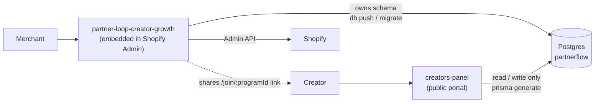

# PartnerLoop — Project Status

**Last updated:** 13 October 2026

PartnerLoop is a creator/affiliate program platform for Shopify merchants. A merchant defines
commission programs, recruits creators with a share link, tracks the orders those creators
generate, and pays out commissions. Creators get their own portal to apply and track their
earnings.

The product spans **two separate applications** that share one Postgres database.

## Status at a glance — 14 October 2026

|                 |                                                                                                                                                                                                                                                                                                                                                                      |
| --------------- | -------------------------------------------------------------------------------------------------------------------------------------------------------------------------------------------------------------------------------------------------------------------------------------------------------------------------------------------------------------------- |
| Features        | Phases 1–18 built. Open: password reset (B1) and email verification (F2), both blocked on a sending domain.                                                                                                                                                                                                                                                         |
| Automated tests | `npm test` in each app — 56 merchant, 40 portal, no database needed. See "Automated review — 2026-10-13".                                                                                                                                                                                                                                                        |
| Database        | Schema in sync: `Commission.terms`, `Store.primaryDomain` and `Store.name` were pushed on 2026-10-14.                                                                                                                                                                                                                                                          |
| Creator portal  | Reviewed screen by screen on 2026-10-14 — see "Creator portal review — 2026-10-14". Roughly 85% feature-complete; the gaps are password reset, email, and creator-facing privacy terms and account deletion.                                                                                                                                                       |
| Portal redesign | In progress (sidebar shell, new Overview, filters, payouts grouping). UI/UX audit: [PartnerLoop Creator Portal — UI/UX Audit](https://claude.ai/code/artifact/f332c46f-9fda-4ffd-a867-e3de5353f8a5). Reviewed again on 2026-10-14 after the latest redesign commits — see "Redesign review — 2026-10-14". Issues: `tests.md`, "Found in testing, not fixed yet". |
| Manual testing  | Live run on 2026-10-14 with both apps up — see "Live testing — 2026-10-14". Setup done; storefront click tracking and the creator-facing pages pass. Left for you: the coupon (A3), the Shopify admin checks (B), real orders and refunds (C).                                                                                                                     |
| Launch blockers | `application_url` placeholder, no hosting for either app, Protected Customer Data access not requested, billing gate off. See `tests.md`, "Open decisions".                                                                                                                                                                                                      |
| Version control | Both repos committed on 2026-10-14, including the click-tracking and hydration fixes. The docs now live in `creators-panel/docs/`. `dev.log` should not be committed.                                                                                                                                                                                            |

---

## Repository layout

```
promote/
├── partner-loop-creator-growth/   Embedded Shopify admin app (merchant-facing)
├── creators-panel/                Public creator portal (creator-facing)
└── PROJECT_STATUS.md              This file
```

Each subdirectory is its **own git repository**. `promote/` itself is not version-controlled.

|                    | `partner-loop-creator-growth`                                                                      | `creators-panel`                                                                                                    |
| ------------------ | ---------------------------------------------------------------------------------------------------- | --------------------------------------------------------------------------------------------------------------------- |
| Audience           | Store owner, inside Shopify Admin                                                                    | Creators / influencers, public web                                                                                    |
| Framework          | React Router 7 (framework mode)                                                                      | Next.js 16 (App Router, Turbopack)                                                                                    |
| React              | 18.3                                                                                                 | 19.2                                                                                                                  |
| UI                 | Shopify Polaris 13 + App Bridge                                                                      | Tailwind CSS v4                                                                                                       |
| Language           | JavaScript (JSX)                                                                                     | TypeScript                                                                                                            |
| ORM                | Prisma 6.19.3                                                                                        | Prisma 6.19.3                                                                                                         |
| Dev port           | via `shopify app dev` (tunnelled)                                                                  | 3001                                                                                                                  |
| Routes             | `/app`, `/app/programs`, `/app/creators`, `/app/commissions`, `/app/payouts`, `/privacy` | `/join/[programId]`, `/login`, `/dashboard` (+ `earnings`, `payouts`, `program`, `links`, `settings`) |
| Tests              | `npm test` (node:test, in-memory fake DB)                                                          | `npm test` (node:test)                                                                                              |
| Owns the DB schema | **Yes**                                                                                        | No — read/write only                                                                                                 |

---

## Architecture

Both apps talk to the same Postgres instance. The Shopify app is the only one holding Admin API
credentials, and the only one permitted to change the schema.



### Schema ownership

`partner-loop-creator-growth/prisma/schema.prisma` is the **single source of truth**.

`creators-panel/prisma/schema.prisma` is a generated copy carrying a "do not edit, do not migrate"
header. Re-sync it after any schema change:

```bash
cd creators-panel && npm run schema:sync   # copies the schema, then prisma generate
```

This exists so `creators-panel` gets a typed Prisma client for the same tables without becoming a
second migration authority. Only the Shopify app ever runs `prisma db push` / `prisma migrate`.

### Currency

`creators-panel` has no Admin API access, so it cannot ask Shopify for the store's currency. The
Shopify app mirrors it onto `Store.currencyCode` — written at onboarding, and reconciled on every
dashboard load via a `updateMany({ where: { currencyCode: { not: current } } })` that is a no-op
after the first run.

---

## Data model

```
Store ─┬─ BusinessInfo
       └─ Program ─┬─ CommissionConfig   (PERCENTAGE | FIXED_PER_ORDER | FIXED_PER_ITEM)
                   ├─ TrackingConfig     (link tracking, coupon tracking)
                   └─ Creator ─┬─ Referral ── Commission ── Payout
                               ├─ Commission
                               └─ Payout

CreatorAccount ── Creator[]        one identity, many program memberships
```

**Identity vs. membership.** `CreatorAccount` holds the person — email (globally
unique), password hash, name. `Creator` is that account's membership of one program, holding the
referral code, approval status and earnings. One person promoting three merchants has one account
and three memberships, so signing in is unambiguous and each merchant's earnings stay separate.

Every downstream entity carries a status enum driving an approval workflow:

| Model          | Statuses                                                |
| -------------- | ------------------------------------------------------- |
| `Program`    | `ACTIVE`, `INACTIVE`                                |
| `Creator`    | `PENDING` → `ACTIVE` / `REJECTED` / `INACTIVE` |
| `Referral`   | `PENDING` → `APPROVED` / `REJECTED`              |
| `Commission` | `PENDING` → `APPROVED` → `PAID` / `REJECTED`  |
| `Payout`     | `PENDING` → `PROCESSING` → `PAID` / `FAILED`  |

### Schema changes made so far

| Model              | Field                                   | Purpose                                              |
| ------------------ | --------------------------------------- | ---------------------------------------------------- |
| `Store`          | `currencyCode String @default("USD")` | Mirrored from Shopify so the portal can format money |
| `CreatorAccount` | *(new model)*                         | Identity + credentials, `email` globally unique    |
| `Creator`        | `accountId String`                    | Now a membership pointing at an account              |
| `Creator`        | `referralCode String @unique`         | Public tracking slug (`?ref=…`) and coupon code   |
| `Creator`        | `approvedAt DateTime?`                | Set when a merchant approves the application         |
| `Creator`        | `@@unique([accountId, programId])`    | An account joins a program at most once              |

Removed from `Creator` when `CreatorAccount` landed: `firstName`, `lastName`, `email`,
`passwordHash` (all moved to the account), and the old `@@unique([programId, email])`.

Added during the creator-portal rework (2026-09-07), both nullable and therefore additive:

| Model                     | Change                                                               | Why                                                                                                                                                                        |
| ------------------------- | -------------------------------------------------------------------- | -------------------------------------------------------------------------------------------------------------------------------------------------------------------------- |
| `CreatorAccount`        | `payoutMethod String?`                                             | How the creator wants to be paid, free text mirroring `Payout.method` (Phase 12)                                                                                         |
| `CreatorAccount`        | `payoutDetails String?`                                            | Whatever that method needs — IBAN, account number, transfer email (Phase 12)                                                                                              |
| `ProductCommissionRule` | `productHandle String?`                                            | Storefront handle, so the portal can build `/products/<handle>?ref=CODE` without Admin API credentials (Phase 13)                                                        |
| *(new model)*           | `LoginAttempt`                                                     | Failed creator sign-ins, for throttling. Pruned on every check; never grows (Phase 14)                                                                                     |
| `TrackingConfig`        | `couponDiscountType DiscountType?`, `couponDiscountValue Float?` | What the *shopper* saves with a creator's code — unrelated to the commission (Phase 5)                                                                                  |
| `Creator`               | `discountNodeId String?`                                           | Shopify GID of that creator's discount, so it can be deactivated and reinstated rather than orphaned (Phase 5)                                                             |
| *(new enum)*            | `DiscountType { PERCENTAGE, FIXED_AMOUNT }`                        | Customer-facing discount; `CommissionType`'s FIXED_PER_ITEM has no meaning for a discount code (Phase 5)                                                                 |
| `Creator`               | `statusReason String?`                                             | Why a membership is not active, quoted to the creator. Covers paused as well as rejected, hence not `rejectionReason` (Phase 15)                                         |
| `Store`                 | `supportEmail String?`                                             | Shopify's customer-facing `Shop.contactEmail`, mirrored so the portal can tell a creator *how* to reach the merchant (Phase 17)                                        |
| `Commission`            | `terms Json?`                                                      | The pricing terms the commission was earned under, frozen at attribution — rates, overrides and the customer type. Refunds re-price through these (review, 2026-10-13)    |
| `Store`                 | `primaryDomain String?`                                            | The storefront's own domain (`brand.com`), mirrored like currency, so the portal accepts and builds links on it (review, 2026-10-13)                                     |
| `Store`                 | `name String?`                                                     | The shop's own name (`Shop.name`), mirrored at onboarding and on dashboard load, so the portal stops calling the store "quickstart-65d173cf" (portal review, 2026-10-14) |

`payoutDetails` is the first financial record the app stores about anyone; the privacy policy names
it explicitly. `productHandle` is backfilled for pre-existing rules by the program editor's loader.

Everything above `Commission.terms` is live on the database (pushed and verified). **`Commission.terms`,
`Store.primaryDomain` and `Store.name` are in the schema but not yet pushed** — see "Status at a glance".

---

## What was built

### `partner-loop-creator-growth` (Shopify admin app)

**Configuration fixes** — `shopify.app.toml`

- Access scopes cut from 20 to four: `read_products,read_orders,read_customers,write_discounts`.
  The old list requested fulfillment, shipping, themes, files, and `read_all_orders` that no code
  used. Over-requesting is an App Store submission blocker (`SHOPIFY_APP_PLAYBOOK.md` §10).
- Added `write_discounts`, which was **missing** — coupon tracking is offered during onboarding but
  cannot generate a discount code without it.
- Removed the template's demo metafield and metaobject definitions. They were the only reason
  `write_metaobjects` / `write_metaobject_definitions` were requested, and they create junk
  definitions in merchant stores.
- `redirect_urls` corrected from `/api/auth` to `/auth/callback`, matching `authPathPrefix: "/auth"`
  in `app/shopify.server.js`. The mismatch would 404 the OAuth callback in production (playbook §6).

**Dashboard now reads real data** — `app/routes/app._index.jsx`, `app/services/dashboard.server.js`

The dashboard previously ran off a hardcoded `const hasData = false` block with literal revenue,
clicks, top creators, and activity entries. It now aggregates from Prisma:

- Revenue and order counts from `Referral`, excluding `REJECTED`, with period-over-period deltas.
- Commission balances grouped by status (`PENDING` / `APPROVED` / `PAID`).
- Creator counts by status, program status, and live link/coupon tracking flags.
- Top creators via `groupBy` on referrals, hydrated with names and commission totals.
- An activity feed merged from recent creator signups and referrals, with relative timestamps
  formatted **server-side** so the markup hydrates identically on the client.
- The Program and Period filters now drive the loader through URL search params instead of being
  decorative. Merging into the existing params preserves Shopify's embedded query string
  (`host`, `embedded`, `id_token`).
- An action-items card surfaces creators awaiting approval and commissions ready to pay.

**Clicks and conversion rate reported "Not tracked yet", not `0`.** There was no `Click` model, so
a zero would have been a number the data could not support. Phase 7 turned both into real figures
once attribution was recording clicks — see "Phase 7" below.

**Creator approval page** — `app/routes/app.creators.jsx` *(new)*

Added beyond the original list, because without it creators sign up and sit at `PENDING`
indefinitely — the signup gap does not actually close. Status tabs with counts, and
approve / reject / deactivate / reactivate actions.

Tenancy is enforced in the query itself: mutations use `updateMany` with a
`program: { shopId: session.shop }` filter, so a creator id belonging to another shop matches zero
rows rather than being updated.

**Signup links now resolve** — `app/services/links.server.js` *(new)*

The old link was `https://${shop}/a/join/${id}` where `shop` had `.myshopify.com` stripped,
producing an invalid domain that could never load. The dashboard separately hardcoded
`https://partnerloop.com/join/standard-8f31`. Both now build from `CREATORS_PANEL_URL`.

**Other**

- `app/periods.js` *(new)* — the period list, shared between the route component and the server
  module. See "Gotchas" below for why this cannot live in a `.server` file.
- Nav updated: template "Additional page" replaced with "Creators".
- Onboarding now records the shop currency when creating the `Store`.

### `creators-panel` (creator portal)

Scaffolded independently as Next.js 16. Prisma 6 added on top.

**Prisma setup**

- `prisma`/`@prisma/client` pinned to `6.19.3`, matching the Shopify app.
- `prisma/schema.prisma` — generated copy of the canonical schema.
- `scripts/sync-schema.mjs` + `npm run schema:sync` — re-copy and regenerate.
- `postinstall: prisma generate` so the client exists after a fresh clone or a Vercel build.
- `.env` holds `DATABASE_URL` only, and is gitignored (`.env*`).

**Library layer** — `lib/`

| File                 | Purpose                                                                                                 |
| -------------------- | ------------------------------------------------------------------------------------------------------- |
| `db.ts`            | Prisma client singleton, reused across dev hot reloads so the shared pool is not exhausted              |
| `password.ts`      | scrypt hashing via `node:crypto` — memory-hard, no extra dependency. Format: `scrypt$<salt>$<key>` |
| `referral-code.ts` | Codes like `SARAHBYPQ` from an unambiguous alphabet (no `O`/`0`, `I`/`1`, `L`)              |
| `money.ts`         | `Intl.NumberFormat` with a fallback, since Intl throws on unknown currency codes                      |

**Registration page** — `app/join/[programId]/`

| File                      | Role                                                                      |
| ------------------------- | ------------------------------------------------------------------------- |
| `page.tsx`              | Server Component: loads program + store, renders program summary and form |
| `actions.ts`            | `registerCreator` Server Action: validation, creation, collision retry  |
| `registration-form.tsx` | Client Component: `useActionState` for field errors and pending state   |

Built against the local Next 16 docs in `node_modules/next/dist/docs/`, as the project's
`AGENTS.md` requires — `params` awaited as a Promise, `PageProps<'/join/[programId]'>` typed route
props, `force-dynamic` so live program state is never cached.

Design decisions:

- **`programId` is bound server-side** with `.bind(null, programId)` rather than posted as a hidden
  field, so it cannot be swapped for a different program by editing the form.
- **The action re-validates everything**, including whether the program is still `ACTIVE`. Server
  Actions are reachable by direct POST, not only through our own UI.
- **Referral code uniqueness is enforced by the database index**, not by a pre-check. The action
  retries on a `P2002` collision — race-safe, unlike check-then-insert.
- Email is normalised to lowercase and trimmed before storage.
- Three render states: the application form, "Applications are closed" for an inactive program, and
  a 404 for an unknown program id.

**Authentication** — `lib/session.ts`, `lib/auth.ts`, `lib/auth-actions.ts`, `app/login/`

Stateless signed-cookie sessions: `<base64url payload>.<HMAC-SHA256>` over `node:crypto`, no
dependency. The payload holds an account id and expiry — signed rather than encrypted, because an
account id is not secret and tampering is the only real threat. Signature comparison is
constant-time, and length is checked first since `timingSafeEqual` throws on a mismatch.

Login is deliberately uninformative: "no such account" and "wrong password" return the same message,
and the unknown-email path burns a comparable scrypt cost so response timing doesn't leak which
addresses are registered. `?redirectTo=` is confined to same-site relative paths.

Registration now creates or reuses a `CreatorAccount`. When the email already has one, the submitted
password must match before a new membership is attached — otherwise anyone could bolt a program onto
a stranger's account by guessing their email.

**Creator dashboard** — `app/dashboard/`, `lib/creator-stats.ts`

Renders by membership status: `PENDING` shows "under review", `REJECTED` and `INACTIVE` get their
own copy, `ACTIVE` gets the full dashboard — six stat tiles, the referral link
(`https://<shop>/?ref=<code>`), the coupon code when the merchant enabled coupon tracking, recent
referrals, and commission history. Accounts in more than one program get a switcher.

Conversion rate showed "Not tracked yet" until Phase 2's clicks were flowing on a live storefront;
Phase 7 made it real. The tile count is now seven, with link clicks alongside orders.

### Phase 2 — attribution capture

The referral link points at the *merchant's storefront*, which neither app serves, and Shopify's
order webhook delivers an order rather than the shopper's browser state. So a cookie alone can never
earn a commission — the code has to be copied somewhere Shopify carries through checkout. That is
the cart attribute, and it is the load-bearing part of this phase.

```
?ref=CODE  →  _pl_ref cookie (30d)  →  cart attribute _pl_ref  →  order
                     ↓
              Click row (via App Proxy)
```

| Piece            | Location                                                                                |
| ---------------- | --------------------------------------------------------------------------------------- |
| `Click` model  | canonical schema, synced to the portal                                                  |
| App Proxy        | `[app_proxy]` in `shopify.app.toml` — `/apps/partnerloop/*` → `<app>/proxy/*` |
| Click endpoint   | `app/routes/proxy.track.jsx` + `app/services/tracking.server.js`                    |
| Storefront embed | `extensions/partnerloop-tracking/` (app embed block + vanilla JS asset)               |
| Embed detection  | `app/services/embed-status.server.js`, surfaced as a dashboard banner                 |

Decisions worth keeping in mind:

- **Last-click.** A fresh `?ref=` always overwrites the cookie and restarts the 30-day window, so
  the most recent creator gets credit.
- **`visitorId`.** An anonymous browser-minted id, without which one shopper refreshing five times
  reads as five clicks and wrecks conversion rate. Repeat clicks on the same code collapse within 30
  minutes.
- **The cart attribute is re-checked on every page load**, not written once. Shopify issues a new
  cart when the old one is cleared or expires, which would otherwise silently drop attribution.
  Reading `/cart.js` first keeps this to a single GET in the common case.
- **Unreferred visitors cost nothing** — no cookie, no requests, zero added weight on the storefront.
- **A redirect that drops the query string destroys attribution, and nothing client-side can save
  it.** The clearest case is storefront password protection: requesting
  `/?ref=CODE` on a locked store redirects to `/password` and the parameter is gone before any HTML
  — let alone our script — is returned. After signing in you land on `/`, the script correctly sees
  no `?ref=`, and does nothing. The same applies to locale and Markets redirects.
  Production storefronts aren't password-gated so this rarely bites real shoppers, but **every
  merchant testing setup on a pre-launch store will hit it** and conclude tracking is broken. The
  fix is to visit the referral URL *after* authenticating to the storefront.
- **The proxy endpoint always answers 200.** It is a fire-and-forget beacon on a shopper's page
  load; a stale or unknown code is an ordinary outcome, not something to surface in a storefront
  console. Signature failures are still rejected by Shopify's verification before any work happens.
- **`read_themes` was added back** to read `config/settings_data.json`. It is the only reliable way
  to tell "embed off" from "no traffic yet". Detection fails open — an API error reports "unknown"
  and shows no warning, so a detection bug never nags a merchant who is set up correctly.

Not in this phase, by design: order attribution, commission creation, coupon tracking, payouts.

### Phase 3 — order attribution

A referred order becomes a `Referral` plus a `Commission`, in one transaction.

| Piece                | Location                                  |
| -------------------- | ----------------------------------------- |
| Webhook subscription | `orders/create` in `shopify.app.toml` |
| Handler              | `app/routes/webhooks.orders.create.jsx` |
| Attribution          | `app/services/attribution.server.js`    |
| Commission maths     | `app/services/commission.server.js`     |
| Backfill             | `app/services/backfill.server.js`       |

**Commission basis: order subtotal after discounts, excluding tax and shipping.** Order #1759 was
Rs 696 total — Rs 600 subtotal plus Rs 96 tax — so 13% pays Rs 78, not Rs 90.48. Paying a
percentage of tax hands creators a cut of government revenue; paying on shipping hands them a cut
of a cost.

**Tax-inclusive stores need the tax stripped back out.** Shops that display tax-inclusive prices —
the norm across the UK, EU and Australia — report a `subtotal_price` that *already contains* tax.
Taking it at face value would pay commission on tax for every one of those merchants while
appearing to honour the rule above. `qualifyingSubtotal` subtracts line-item `tax_lines` when
`taxes_included` is true, deliberately not `total_tax`, which can also cover tax on shipping.
A £120 tax-inclusive order (£100 goods + £20 VAT) pays 13% of £100 = £13, not £15.60.
This dev store is tax-exclusive (`taxes_included: false`), so #1759 is unaffected.

**Idempotency is explicit, with the database as backstop.** Shopify delivers webhooks at-least-once,
so `attributeOrder` looks the order up by `orderId` first and no-ops if it is already attributed.
The unique index on `Referral.orderId` only catches what that lookup cannot: two deliveries racing,
both reading "not found" before either writes. Relying on the constraint alone would mean treating
an ordinary redelivery as an exception.

**Both records are written in one `$transaction`.** A referral without its commission would show the
merchant attributed revenue that nobody will ever be paid for.

**Commissions are not immutable, and the code is built that way.** `calculateCommission` is pure and
takes the qualifying figures as arguments, so a refund handler re-runs it with smaller numbers
rather than needing new logic. `qualifyingSubtotal` and `qualifyingItemCount` already prefer
Shopify's `current_*` fields, which track refunds and order edits, falling back to the originals.
Cancellation and refund handling is Phase 6 work, but nothing here assumes a commission is final.

**The handler runs inline rather than deferring**, which departs from playbook §2 deliberately: that
pattern protects handlers that fan out over unbounded data, whereas this one does two indexed
lookups and one small transaction. Idempotency is what makes it safe — a Shopify retry after a
timeout cannot double-pay.

There is intentionally **no cap** at the order subtotal. A `FIXED_PER_ORDER` rule larger than a small
order genuinely owes more than the sale was worth; that is the merchant's configured rule, and
silently clamping it would hide the misconfiguration. Minimum-order-value guards belong in Phase 4.

### Phase 4 — commission rules

Three layers, resolved in a fixed order. This is the whole of the rule engine; anything not listed
here is deliberately absent.

```
minimum order value      ── a gate, not a rule: below it the order earns nothing
        │
        ▼
1. product override      ── per line item      (PERCENTAGE | FIXED_PER_ITEM)
2. customer-type rule    ── new vs returning   (all three types)
3. program default       ── everything else    (all three types)
```

| Layer | Model                                  | Applies to                                                   |
| ----- | -------------------------------------- | ------------------------------------------------------------ |
| Gate  | `CommissionConfig.minimumOrderValue` | whole order, before any rule                                 |
| 1     | `ProductCommissionRule`              | lines whose product matches                                  |
| 2     | `CustomerCommissionRule`             | lines no product rule claimed                                |
| 3     | `CommissionConfig`                   | lines no product rule claimed, when no customer rule matched |

Points that are easy to get wrong, and how they are settled:

- **Product rules cannot be `FIXED_PER_ORDER`.** "£10 if Product A is present" has no sensible
  answer when two such products share an order. Customer-type rules *can* be, because a customer is
  an order-level fact.
- **A customer-type rule replaces the default**, it does not stack with it. Only lines that no
  product rule claimed are affected.
- **`FIXED_PER_ORDER` is added once**, and only if at least one line actually fell back. Override
  every line and the flat amount is not added at all.
- **Guest checkouts fall through to the program default.** `customerTypeOf` returns null when the
  order carries no customer, rather than guessing "new" — guessing would quietly pay the higher
  acquisition rate to anyone who declines to make an account. `orders_count` includes the order
  being placed, so a first-time buyer arrives as 1, not 0.
  *(2026-10-13: Shopify stopped sending `orders_count` in order webhooks in API 2025-01, so on live
  orders this layer never fired. The customer type is now looked up through the Admin API and
  frozen in `Commission.terms` — see "Automated review", findings 1–3.)*
- **The minimum is a gate above everything.** A generous 20% product override on a small order still
  earns nothing. Blank or zero means no minimum, not a minimum of zero.
- **The calculation basis is unchanged** from Phase 3: subtotal after discounts, excluding tax and
  shipping, with tax stripped back out on tax-inclusive stores.

Both rule sets are managed from the program editor — products through Shopify's native resource
picker, customer rates and the minimum through the "Advanced commission" card. The action
re-validates every rule server-side and checks program ownership before writing.

**Deliberately not built.** Flagged here so they are choices rather than oversights, to be picked up
only if a real requirement appears:

| Idea                   | Note                                                                    |
| ---------------------- | ----------------------------------------------------------------------- |
| Collection-level rules | The editor has an "Excluded products/collections" card still marked PRO |
| Lifetime commissions   | Pay on a referred customer's *future* orders, not just the first      |
| Coupon-specific rates  | A different rate for orders using a particular code                     |
| Tiered / volume rates  | "20% after £5k of referred sales this month"                           |
| Per-creator overrides  | A negotiated rate for one creator inside a shared program               |
| Maximum commission cap | Counterpart to the minimum gate                                         |

### Phase 6 — commission lifecycle and payouts

```
PENDING ──→ APPROVED ──→ PAID
   └────→ REJECTED (reason required)
```

**Referral and Commission are deliberately separate concepts.** A referral records *"Sarah generated
this order"*; a commission records *"Sarah is owed for it"*. A refund invalidates the second without
touching the first. Rejecting a commission therefore never rejects, deletes or alters its referral —
doing so would erase a creator's work from reporting the moment money was clawed back.

The dashboard reflects that split:

| Figure                                           | Meaning                                      |
| ------------------------------------------------ | -------------------------------------------- |
| Attributed revenue                               | Every order a creator generated              |
| Commissionable revenue                           | The subset whose commission was not rejected |
| Commissions pending / approved / paid / rejected | Where the money itself stands                |

**Review screen** (`/app/commissions`) — tabs for Pending, Approved, Paid, Rejected with counts.
Commissions are grouped by creator with a running total, so a merchant can approve a batch in one
click, while every row remains individually selectable and rejectable. Rejection requires a reason,
which is stored on the commission and shown thereafter.

**Payouts** (`/app/payouts`) — manual only, no payment provider. A payout groups a creator's
approved commissions, and the selection is deliberately narrow:

| Commission state                  | Selectable               |
| --------------------------------- | ------------------------ |
| `PENDING`                       | no — not approved yet   |
| `REJECTED`                      | no                       |
| `APPROVED`, already on a payout | no                       |
| `PAID`                          | no — money already sent |
| `APPROVED`, `payoutId` null   | **yes**            |

Linking a commission to a payout is what removes it from the pool, so a stale form or a double-click
matches zero rows the second time rather than paying twice. Commissions stay `APPROVED` until the
payout is marked paid; that step is where they become `PAID`, because that is when the money
actually moved.

Each payout records a human-readable number (`PL-0001`), method, the merchant's own payment
reference, an optional note, and `paidAt` — enough to answer *"did I actually pay Sarah for this?"*
six months later.

**Hold period — modelled, not enforced.** `CommissionConfig.holdDays` and `Commission.eligibleAt`
exist, and `eligibleAt` is stamped at attribution time rather than computed on read, so changing a
program's hold period never retroactively moves money already promised under the old terms. The
review screen shows a "Hold until …" badge, but approval is not blocked in V1. Enforcing it later is
a condition, not a migration.

### Phase 6b — refund accounting

An order can change after it has been attributed. Three rules govern what happens next.

**1. Nothing is overwritten.** `Commission.originalAmount` holds the entitlement at attribution and
never moves. Every change lands in `CommissionAdjustment`, an append-only ledger of signed deltas.
That is what lets the app say *"Rs 130 originally, −Rs 39 refunded, Rs 91 now"* instead of quietly
displaying a smaller number than the merchant remembers approving. `originalAmount` plus the ledger
always reconciles to `amount`.

**2. Entitlement is recomputed, never scaled.** The refund payload's line items are deliberately not
used to derive the new figure. Instead the order is re-read and repriced through
`calculateOrderCommission` — the same engine that priced it originally. This is the only approach
that survives per-product overrides:

> An order of Product A (Rs 1000 @ 20%) + Product B (Rs 1000 @ 13%) earns Rs 330. Refund **only
> Product A** and the commission must become **Rs 130**, not Rs 165. Halving the order does not halve
> the commission, because the two products were never worth the same rate.

*(2026-10-13: "the same engine" now also means the same terms — refunds price through the rates
frozen in `Commission.terms` at attribution, not the program's current ones — and the re-read
order includes order-level discounts and scales discount and tax to the units remaining. See
"Automated review", findings 2–5.)*

**3. Money that has been paid cannot be un-paid.** What happens to a refund depends on where the
commission had got to:

| Commission state | Effect of a refund                                                                 |
| ---------------- | ---------------------------------------------------------------------------------- |
| `PENDING`      | `amount` adjusted down; drops to `REJECTED` if entitlement reaches zero        |
| `APPROVED`     | same, and it stays `APPROVED` if anything remains                                |
| `PAID`         | `amount` is **frozen** at what was actually paid; the delta becomes a debt |

For a paid commission the shortfall surfaces as a **creator balance owed**, derived from the ledger
rather than stored, and shown on the commissions screen. Settling it against a future payout is a
merchant decision — V1 never claws money back automatically.

**Cancellations** take entitlement to zero without re-reading the order, since a cancelled order
earns nothing whatever its line items still say. As everywhere else, the `Referral` is untouched.

Redelivery is safe: `@@unique([commissionId, sourceId])` on the ledger means a webhook Shopify sends
twice deducts once.

### Phase 7 — click analytics

Clicks had been recorded since Phase 2 but neither dashboard read the table, so both still showed
the Phase 1 placeholder. This phase wires the `Click` rows through to the two surfaces that need
them, and nothing else — no new tracking, no schema change.

**Merchant** — `app/services/dashboard.server.js`, `app/routes/app._index.jsx`

Three queries join the existing `Promise.all`: clicks in the period (with `createdAt`, so they can
be bucketed into the chart), a count for the previous period to drive the change delta, and a
`groupBy` for the per-creator table. They scope by `Click.programId` rather than through `inScope`'s
creator join — identical rows, but it hits `@@index([programId, createdAt])` directly, and clicks
are by far the highest-volume table here.

Clicks became a selectable chart series, and the top-creators table gained Clicks and Conversion
columns.

**Creator** — `creators-panel/lib/creator-stats.ts`, `app/dashboard/page.tsx`

One `click.count` for the membership, and the same `orders / clicks` derivation. A "Link clicks"
tile now sits beside Orders, so the conversion figure has its inputs visible next to it.

**Conversion rate is null, not zero, when there are no clicks.** This is the one real decision in
the phase. `0%` reads as *nobody bought*; the truth is *nobody visited*. Those are opposite
diagnoses — one says the offer is broken, the other says the reach is — and a creator's income
depends on knowing which. Both dashboards render an em dash with a footnote instead, and both say
so where the number would be:

- merchant: "No referral link visits yet" / "Needs at least one click" / "3 of 7 visits bought"
- creator: "No link clicks yet" / "3 of 7 visits bought"

The same nullability applies per creator in the top-creators table, where it also covers a creator
who has orders but no clicks — real when a coupon drove the sale, or when the click predates the
selected period.

**Both sides count orders the same way** (`status: { not: "REJECTED" }`), so a creator comparing
their portal against what the merchant sees cannot find a discrepancy.

The displayed rate is rounded to one decimal, but the period-over-period delta is computed from the
unrounded ratio — comparing a rounded figure against an unrounded one manufactures a small change
out of nothing.

**Verified against the live dev store**: 7 clicks, 3 attributed referrals, 42.9% — all from Sarah
Jenkins (`SARAHQ7X2`). Mike Ross, who has no clicks, is the null case.

### Phase 8 — App Store readiness

Four submission blockers from `SHOPIFY_APP_PLAYBOOK.md`, three now closed in code.

**The three mandatory privacy webhooks** (§3) — declared with `compliance_topics`, not `topics`, so
Shopify routes them as privacy requests. An app without all three is rejected.

| Topic                      | Behaviour                                                    |
| -------------------------- | ------------------------------------------------------------ |
| `customers/data_request` | Reports the order references held for the named orders.      |
| `customers/redact`       | Acknowledges — there is no customer personal data to erase. |
| `shop/redact`            | Deletes the shop and everything belonging to it.             |

**The app stores no customer personal data, and that is a property of the schema rather than a
claim.** A `Referral` holds an order id, number and amount; a `Click` holds a visitor id the app
mints itself, a landing path and a referrer. No name, email, address or phone is ever written.
That is what makes `customers/redact` a genuine no-op rather than an unimplemented handler.

**Creators are deliberately out of scope for a customer redaction.** A creator is the merchant's
business partner and their account anchors payout records the merchant must retain; deleting it
because that person also shopped at the store would destroy financial history rather than personal
data. Creators are removed by `shop/redact`, the request that actually ends the relationship.

**`shop/redact` has one non-obvious job.** Deleting the `Store` cascades programs, rules, creators,
referrals, commissions, payouts and clicks — but *not* `CreatorAccount`, because accounts are shared
across shops and the cascade runs account → memberships, never upward. That would strand accounts
holding a name and email, which is exactly the data the webhook exists to remove, so accounts left
with no memberships anywhere are deleted explicitly.

**Privacy policy** (§5) — `app/routes/privacy.jsx`, a loader returning HTML with no component and no
App Bridge, so nothing can pull it behind `authenticate.admin`. It documents each requested scope,
what is stored, both storefront cookies, and how deletion works. Keep it in step with the code: a
reviewer compares it against the manifest, and the scope list is currently verified to match.

**Managed-pricing gate** (§4) — `billing.server.js` plus `app/routes/app.select-plan.jsx`, gated in
the app layout. No billing code: plans live in the Partner Dashboard and Shopify hosts the selection
page. Two rules the playbook insists on, both implemented:

- **Fail open.** Any error in the subscription lookup resolves to "let them through". A billing
  check must never lock a merchant out of their own app.
- **Flag-guarded.** `BILLING_GATE_ENABLED` must stay `false` until plans exist in the Partner
  Dashboard — switching it on first bounces every merchant to an empty pricing page and makes the
  app unusable. It is the final switch before submission.

> ⚠️ The flag was found set to `"true"` in `.env`, carried over from the app this was templated
> from, with no plans configured. Wiring up the gate would have bounced the dev store to an empty
> pricing page on the next load. Set to `"false"`, which is the correct pre-submission value.

The app handle in the pricing URL is derived at runtime from `currentAppInstallation.app.handle`
rather than hardcoded, because it gains a numeric suffix when the base name is taken; a wrong handle
sends merchants to a page that does not exist. `SHOPIFY_APP_HANDLE` overrides it if needed.

**Still outstanding — only you can do these:**

1. **Configure plans in the Partner Dashboard**, then flip `BILLING_GATE_ENABLED` to `"true"`.
2. **Set `application_url`** to the real production origin. It is still `https://example.com`;
   `shopify app dev` rewrites it per run, but a bare `shopify app deploy` pushes the placeholder.
3. Point `SUPPORT_EMAIL` at a monitored address — the privacy policy publishes it.
4. Replace `README.md` and `CHANGELOG.md`, still the stock Shopify template docs.

---

### Phase 9 — portal shell

Closes audit findings C1, C2, C3, C4 and D1. Deliberately the cheap phase: it exists so phases 10-13
have routes and a palette to land in, rather than growing the single dashboard page past 600 lines
and then splitting it.

**Routing.** `/dashboard` became a segment with a layout. Overview keeps the tiles, share card and a
five-row earnings preview; `/dashboard/earnings` holds the full list. The layout owns the header,
tab strip and program switcher.

`?program=` stays a query parameter rather than moving into the path. The App Router does not give
layouts access to `searchParams`, so the tab strip and switcher are client components reading it
directly — dropping the parameter would silently bounce a multi-program creator back to their
default program on every tab change. Switching program also preserves the current tab.

`app/dashboard/guard.tsx` holds the one check every page runs: resolve the membership, then render
the no-programs or not-active screen instead of the page. Centralised because a page that forgot the
ACTIVE check would show a pending applicant a referral link that earns them nothing.

**The two tables became one.** `Commission.referralId` is `@unique` and `attributeOrder` writes both
rows in a single transaction, so referrals and commissions are strictly 1:1 — "Recent referrals" and
"Commission history" were rendering the same events twice with a different status column each. They
are now one row per referred order, with the two statuses collapsed by
`lib/earning-status.ts` into the single question a creator is asking:

| Situation               | Shown as     |
| ----------------------- | ------------ |
| Referral rejected       | Not credited |
| Commission `PENDING`  | Pending      |
| Commission `APPROVED` | Approved     |
| Commission `PAID`     | Paid         |
| Commission `REJECTED` | Declined     |
| No commission row       | Processing   |

The referral-vs-commission split stays in the schema, where it belongs — it is a merchant's
distinction, not something a creator should have to reconcile across two tables.

**Route states.** `error.tsx` at the root and inside `/dashboard`, `not-found.tsx`, and a skeleton
`loading.tsx` shaped like the overview so the layout does not jump. The dashboard-scoped boundary
sits inside the layout, so a failure keeps the tabs and switcher usable instead of dead-ending.

Next 16 renamed the error boundary's prop: it is `retry`, which re-fetches and re-renders, not
`reset`, which only clears error state. `retry` became stable in 16.3.0 — exactly the version pinned
here. Verified against `node_modules/next/dist/docs` rather than assumed.

**Dark mode, implemented rather than deleted.** `globals.css` previously flipped two variables under
`prefers-color-scheme: dark` that no surface honoured, so a dark-mode phone got a dark body behind
entirely light cards. It now carries a full semantic token set — `canvas`, `surface`, `line`, `ink`,
`brand`, and status roles `warn` / `info` / `ok` / `bad` / `neutral` — defined once per theme and
mapped through `@theme inline`. Components reference roles (`bg-surface`, `text-ink-muted`,
`bg-bad-surface`), never raw palette values, so phases 10-13 inherit both themes for free.

Dark is not the light palette inverted: `brand` and `brand-text` diverge because blue-700 on
near-black fails contrast as a link colour, and the status grounds are deep and desaturated because a
bright tint at badge size reads as an alert rather than a label. The one intentional exception is the
join page's gradient panel, a fixed brand surface in both themes.

**Scaffold removal.** The root layout said `title: "Create Next App"`; it now uses a title template so
child segments set a bare string, with a real default for the 404. `body` carried
`font-family: Arial`, overriding the Geist font the layout loads — every page was working around it
with a manual `font-sans` class. Font and ground now live on `<body>` once.

**Verified against the running app**, not just the build — this project has a long record of defects
that passed build, lint and typecheck. With a minted session for Sarah on the dev store:
`/dashboard` 200 with 7 tiles reconciling (PKR 120 paid + PKR 102 approved = PKR 222 earned, the
rejected PKR 78 correctly excluded) and one merged table showing #1763 Paid, #1762 Approved, #1759
Declined; `/dashboard/earnings` 200 with all three rows; tab `aria-current` correct on both routes;
`?program=` threaded into every tab link; a foreign membership id falling back to the creator's own
program rather than erroring or leaking; Mike (`PENDING`) getting the under-review screen with no
referral link; `/join/<bad-id>` and an unknown path both returning 404 with the branded page; and the
compiled CSS carrying every token utility plus the full dark block.

**Left for later phases on purpose.** The earnings table is still a horizontally-scrolling table on
phones (D2, Phase 11) and still capped — now at 50 rows, and it says so on screen rather than
truncating silently at 10 (A5, Phase 10).

---

### Phase 10 — money truth

Closes audit findings A1 through A6. Every field surfaced here already existed in the schema; none of
it had ever reached the creator. No migration, no new tracking — just wiring records built in phases
6, 6b and 7 to the person they are about.

**Payouts** (`/dashboard/payouts`, A1). `prisma.payout` had never been queried by the portal. Each
payout now shows its `PL-0001` number, amount, status, method, the merchant's own reference, any
note, and which orders it settled — because the point of a reference is being able to check it
against what actually arrived. Missing fields say "Not recorded" / "None given" rather than rendering
an empty cell.

**Balance owed back.** A refund that lands after payment cannot claw money back, so `Commission.amount`
freezes and the shortfall becomes a debt in the ledger. `getOwedBack` mirrors the merchant's
`getCreatorBalances` derivation exactly — sum the adjustments on PAID commissions, flip the sign,
show only a positive result. The merchant already saw this figure; now the creator sees the same one,
so a smaller next payout is not a surprise.

**Every row explains itself** (A2, A3, A4). The earnings table gained two explanation lines:

- Under the amount, when the adjustment ledger is non-empty. The wording splits on whether the money
  has left, because the two cases mean opposite things: unpaid reads *"Was PKR 130 · PKR 26
  refunded"* (the entitlement moved), paid reads *"PKR 26 owed back — refunded after payout"* (the
  amount shown is still exactly what was sent, and what changed is that they now owe).
- Under the status badge: the hold date while pending, the payout number once paid, and the
  merchant's `rejectionReason` verbatim when declined. The merchant is *required* to give a reason;
  the creator could never see it, which made it the most likely support ticket in the product.

The overview preview passes `showDetail={false}` — a glance, not an investigation.

**Real data caught a bug.** Order #1762 is `APPROVED` *and* already attached to payout PL-0004, which
has not been sent. The first version of the hint said "waiting to be included in a payout", which was
flatly wrong — it is already in one. `APPROVED` now branches on whether a payout is attached, matching
the merchant-side split between "ready to pay" and "in payout". This is exactly the class of defect
that only shows up against real rows.

**Pagination** (A5). Offset-based with a total count, so the page can say "Showing 1–25" and "Page 2
of 4" — a cursor cannot answer "how much is there". History previously stopped at ten rows with
nothing on screen to indicate more existed. `?page=` is clamped to a real page, so `?page=999` lands
on the last one rather than an empty table.

**How you earn** (`/dashboard/program`, A6). The join page promises "13% of every sale" and that
number used to vanish the moment someone became a member — while `lib/auth.ts` fetched
`commissionConfig` on every dashboard load and threw it away. The page now shows the standard rate,
new-vs-returning rates, per-product overrides (`productTitle` is denormalised, so naming them costs
no Admin API call), the minimum order value, the hold period, and how sales get credited.

It also states the precedence chain explicitly, because it is not decoration: a creator promoting a
product with a 20% override needs to know that rate *replaces* the 15% new-customer rate rather than
stacking with it. Sections are omitted entirely when a program has no such rules, so a simple program
reads simply.

**Verification.** Real dev-store data covers payouts (PL-0004 pending with no method or reference,
PL-0005 paid by bank transfer with a note), the rejection reason on #1759, the payout number on
#1763, the approved-in-pending-payout case on #1762, and all three rule types — 13% standard, 15%
new-customer, 20% on The Collection Snowboard: Hydrogen, which is precisely why #1763 earned 120.

Hold dates, refund adjustments and the owed-back path have no rows on the dev store. Rather than
seeding fake refunds into live test data, those branches were exercised through the real components
via a temporary route, since deleted: future and past `eligibleAt`, unpaid-with-refund,
paid-with-refund, referral-rejected, missing-commission, whitespace-padded rejection reason, and
approved-in-payout all produced the right label, tone and hint. Paging was proven by forcing a page
size of 2 over 3 rows: `pageCount` 2, page 1 `#1763,#1762`, page 2 `#1759` — no overlap, no gaps.
Malformed `?page=` values (`abc`, `-1`, `0`, `1.5`, `%27`, `999`) all return 200 with the correct rows.

**Note on currency display.** PKR is a zero-decimal currency in Intl's data, so a commission of 102.17
renders as "PKR 102". That is correct convention for the currency, not a rounding bug, and the stored
value is untouched.

---

### Phase 11 — mobile and trend

Closes audit findings D2 and D3.

**Cards on phones, table on desktop** (D2). Creators are overwhelmingly mobile, and the table put
"Your commission" — the number they opened the portal for — furthest off the right edge behind a
horizontal scroll. The card layout leads with it: order and status on top, commission largest,
order value secondary, explanations underneath.

Both presentations render from one view model (`toView`) rather than from the raw row, so they
cannot drift into disagreeing about what an order earned or why. `components/earnings-table.tsx`
became `components/earnings-list.tsx`, since half of what it renders is no longer a table.

**Trend** (D3). `lib/trend.ts` buckets commission by `Commission.createdAt` — when it was *earned*,
so a bar lines up with the day of the sale rather than the day a merchant got round to approving it.
Rejected commissions are excluded, matching `commissionEarned`: they were never earned, so they must
not raise a bar. Buckets switch from daily to weekly above 31 days, because 90 daily bars are
unreadable on a phone.

The chart is CSS flex bars, not a charting library: a dozen lines, fluid at any width, and it
inherits the theme tokens so dark mode needed no extra work. Two deliberate choices in it — a bar
that would round below 2% is floored so a non-zero day stays visible, while zero days stay genuinely
empty, because a floor on those would invent activity that never happened; and an all-zero period
renders an empty state instead of a chart, since every bar would otherwise be full height against a
zero scale and read as a flat run of maximum earnings.

**Kept separate from the lifetime tiles.** The trend section has its own period and its own numbers
rather than being folded into the stat grid. Those tiles are running totals, and quietly redefining
"Total sales" to mean "last 30 days" would change what a number means without saying so.

`percentChange` returns null when the previous period was empty — there is no percentage change from
zero, "+100%" is arithmetic nonsense and "0%" is a lie — so the UI says "No activity in the previous
30 days to compare". It lives in `lib/change.ts`, a pure module, not in `lib/trend.ts` which is
`server-only`: a change indicator is presentational and will eventually be wanted client-side, and
every previous instance of that leak compiled and typechecked fine before failing at runtime.

**Verified against the running app.** With the dev store's activity on 10-11 Aug and today 6 Sep:
30 days renders two bars at exactly 100% (PKR 120) and 85.14% (PKR 102.17 / 120); 90 days collapses
both into one weekly bar; 7 days correctly shows the empty state, since the activity falls outside
it. Bar tooltips read "Aug 10: PKR 102 from 6 clicks" and "Aug 11: PKR 120 from 1 click", matching
the recorded click distribution and getting the singular right. `?days=999` and `?days=abc` both fall
back to 30. Both layout trees ship, the compiled CSS carries `md:hidden` / `hidden md:block` at the
48rem breakpoint, and the trend section does not leak onto the earnings route.

---

### Phase 12 — account

Closes audit findings B2 and B3. **B1 (password reset) was deliberately not built** — see below.

**Password reset is still open, by decision.** There is no email infrastructure anywhere in either
app: no mailer package, no SMTP settings, no provider key. A reset link that cannot be delivered is
not a feature, and adding a provider needs an API key and a verified sending domain that only the
merchant can supply. Rather than build something untestable, the phase shipped everything else. A
locked-out creator still needs a database script, which is exactly the hole B1 describes, and it
stays on the list.

**Account settings** (`/dashboard/settings`, B2). Name, email and password, each its own form and its
own Server Action.

Deliberately *not* behind `resolveMembership`. Everything on this page belongs to the account rather
than to a program, so a creator whose only application is still `PENDING` — or who was rejected —
must still be able to change their password and fix their name. Gating it on an ACTIVE membership
would lock exactly the people most likely to have mistyped something at signup out of correcting it.

Changing the email is gated on the current password, because it changes how the account signs in;
without that gate, anyone borrowing an unlocked browser could quietly move the account to an address
they control. Email collisions are caught by the unique index rather than a check-then-write, which
would race a concurrent signup.

Settings is reached from a header link, not a tab: the tabs are program-scoped and this is not. The
link stays visible on mobile where the name is hidden, otherwise phones would have no route to it,
and the program switcher hides itself on this route rather than sitting there doing nothing.

**Payout details** (B3) — the one schema change in the whole portal rework:

```prisma
payoutMethod    String?   // "Bank transfer", "Wise", "Easypaisa"
payoutDetails   String?   // IBAN, account number, transfer email
```

Free text, mirroring `Payout.method` which is already free text, because payout practice varies by
country and a fixed set of bank columns breaks for anyone whose details do not fit them. Per-account
rather than per-membership: a creator is paid the same way by every merchant they work with. Applied
with `prisma db push` from the Shopify app, which owns the database, then `npm run schema:sync` in
the portal. Both columns are nullable, so the change was additive with no data loss.

**The merchant has to be able to read them**, or capturing them is pointless. `getPayouts` now
selects both fields and the "Mark as paid" modal shows them in a banner *above* the reference field —
it is what you need in front of you while making the transfer, not after recording it. A creator who
has not filled them in produces a warning banner naming them, rather than silence.

**Privacy consequences, handled.** This is the first financial detail the app stores about anyone, so
the Phase 8 privacy policy gained a row in the data table and a note stating plainly that these
belong to the creator, are supplied voluntarily, can be cleared at any time, and are readable in
unencrypted form because a payment cannot be made from a hash. The "no customer personal data" claim
is untouched and still true — a creator is not a customer. `compliance.server.js` comments were
corrected too: `purgeShop` already removed orphaned accounts and therefore these fields, but its
docstring described the account as holding only "a name and email".

**Verification.** Server Actions are where this project's worst defects have lived, so every form was
submitted through the real no-JS progressive-enhancement path — the exact path `.bind()` wedged in
Phase 1 — by replaying the `$ACTION_REF` / `$ACTION_N:0` / `$ACTION_N:1` encoding Next 16 emits.
Nothing timed out, so nothing wedges. Each validation branch returned its own message: details
without a method, wrong current password, mismatched confirmation, too-short password, blank name,
malformed email.

The database then confirmed the important half: after an attempt to move the account to
`hijack@evil.test` with a wrong password, the email was unchanged and no such account existed; the
name survived the blank-name submission; the saved payout details survived the invalid one. The happy
path wrote correctly, and the merchant-side query returns `method="Wise" details="sarah@example.com"`
on both PL-0004 and PL-0005.

**Test data note:** Sarah's payout details are now set to Wise / sarah@example.com from that
verification. They are editable in the portal under Settings.

---

### Phase 13 — sharing tools

Closes audit findings E1 and E2. The creator's actual job is sending people to the store, and the
portal offered exactly one link: the home page.

**Link builder** (`/dashboard/links`, E1). Paste a product or collection link, a bare path like
`/products/snowboard`, or nothing at all for the home page, and get a tracked link back as you type.
`lib/share-links.ts` is pure, not `server-only`, precisely so the client component can rebuild the
URL per keystroke — a round trip to concatenate a string would be absurd.

Two rules it enforces that matter more than they look:

- **Off-domain input is rejected, not silently rehosted.** A creator pasting a competitor's URL —
  or anything that isn't their merchant's store — is told so by name, rather than handed a link that
  quietly points somewhere they didn't intend.
- **An existing `ref` is overwritten, not appended.** Creators share links with each other, and
  pasting one that already carries somebody else's code must not produce a URL with two `ref` values
  where the storefront picks one and nobody can tell which. `searchParams.set` decides it.

**Product links, and a second schema change.** `ProductCommissionRule` stored `productId` and
`productTitle` but not the storefront handle, and a Shopify product URL needs the handle — the id is
unusable in a storefront path. `productHandle String?` was added; the Admin resource picker already
returns it and simply wasn't persisting it.

Rules saved before this have no handle, and re-saving cannot invent one because the picker never runs
again for a product already in the list. So the program editor's loader repairs them: one `nodes(ids:)`
query while any handle is missing, persisted, never repeated. It is wrapped in try/catch and warns
rather than throwing — a missing handle costs a creator one ready-made link and is never worth
failing the editor over. Until a merchant opens their program once, the portal names the product and
points at the builder rather than showing a broken link.

**QR codes** (E2). A new `qrcode` dependency, used **only** in the route handler, so nothing reaches
the client bundle — verified against the built chunks.

`/dashboard/links/qr` deliberately never accepts an arbitrary `?url=`. It takes a membership id and a
path, resolves the membership against the signed-in account's own list, and runs the path back
through `buildTrackedLink`. Without that it would be an open QR generator on an authenticated origin
— a tidy way to dress a phishing link up as a PartnerLoop URL. It is `Cache-Control: private`, since
the encoded URL carries one creator's referral code and a shared cache handing it to somebody else
would credit the wrong person. The QR renders on a permanent white ground rather than the theme
surface, because a dark-mode inversion defeats most scanners.

**Verification.** Every generated QR was compared byte-for-byte against one generated independently
from the URL it should encode: home page, bare path, full store URL, and — the case that matters —
a pasted link carrying `ref=SOMEONEELSE`, which correctly came back encoding Sarah's code instead.
The endpoint returns 401 with no session, 400 for an off-domain host and for a `javascript:` scheme,
and 200 `image/svg+xml` for valid input. A foreign membership id returns 200 but for the creator's
*own* link, which is `selectMembership` falling back as designed rather than a leak.

**Note:** the dev store's one product rule (The Collection Snowboard: Hydrogen) still has no handle —
the stored offline access token had expired, so it could not be backfilled from here. Opening that
program in the Shopify app repairs it automatically.

---

### Phase 14 — hardening

Closes audit finding F1. **F2 (email verification) is not built** — it needs the same mail delivery
B1 does, and that is blocked on a sending domain. See "Email delivery" below.

**Login rate limiting** (F1). Before this, an attacker could guess passwords against a known creator
email indefinitely. scrypt makes each guess slow, but slow times unlimited is still unlimited.

Database-backed, not an in-memory counter. The portal is a Next app that may run as several
instances or as serverless functions, where a per-process `Map` resets constantly and throttles
nothing at all. A `LoginAttempt` table with `@@index([scope, createdAt])` holds failures, pruned on
every check so it stays roughly the size of one window rather than growing forever — no scheduled job
needed.

Two buckets, defending against different attacks: **8 failures per email per 15 minutes** stops one
account being ground down, and **40 per IP** stops one attacker sweeping many accounts, which the
email bucket alone would never notice. The IP limit is deliberately loose because an office, a school
or a phone network shares one address.

Three decisions worth keeping:

- **The check runs before the account lookup**, so a throttled attacker never gets to probe the
  database at all.
- **A successful sign-in clears the email bucket but not the IP bucket.** Someone working through a
  list of accounts will eventually hit a valid one, and resetting their IP budget then would hand
  them a free refill exactly when they are succeeding.
- **The email bucket does allow a deliberate lockout** — anyone can burn a creator's eight attempts
  for them. That is the standard trade and strictly better than unlimited guessing: the window is
  short, and the IP bucket catches whoever is doing it long before they can sustain it.

`x-forwarded-for` is client-supplied and forgeable unless a trusted proxy overwrites it, which Vercel
and most managed hosts do. The IP bucket is a speed bump; the email bucket is the one that cannot be
sidestepped by forging a header.

**Verified by attacking it.** Eleven wrong passwords against a real account: eight rejected, ninth
onward throttled with a 15-minute wait. The same run against an address that does not exist throttled
at exactly the same point with an identical message — so throttling leaks nothing about which emails
are registered, preserving the enumeration defence the constant-time hash already provided. After
clearing, three failures then the correct password produced a session cookie, and the buckets
afterwards read `ip:::1=3` with the email bucket gone — the asymmetry above, working.

---

## Refund path verification — 2026-09-08

The refund accounting built in Phase 6b and surfaced in Phase 10 had never run against real rows: the
dev store has no refunds. Synthetic `CommissionAdjustment` rows were seeded — replicating exactly
what `recalculateCommissionForOrder` writes — then removed, with the baseline restored to the value
recorded beforehand.

**Both display cases are correct.** An unpaid commission (#1762, PKR 102.17) moved to PKR 61.30 and
read *"Was PKR 102 · PKR 41 refunded."* A paid one (#1763, PKR 120) stayed frozen at PKR 120 and read
*"PKR 48 owed back — refunded after payout."*, with the Payouts tab showing a PKR 48 balance-owed
card. The frozen-amount distinction works: the paid commission still shows what was actually sent,
and the shortfall is reported separately rather than by quietly rewriting history.

### Bug found and fixed: stale payout totals

Seeding surfaced a real defect in the money path that no amount of reading would have shown.

`Payout.amount` is summed when the payout is created. A refund landing on an `APPROVED` commission
that is **already grouped into an unpaid payout** updated `commission.amount` and left the payout
total untouched — `refunds.server.js` even selected `payoutId` but never used it, and `markPayoutPaid`
only flips status without recomputing.

Concretely: PL-0004 kept claiming PKR 102.17 while the single commission inside it was worth
PKR 61.30. **The merchant would have paid PKR 40.87 too much**, and the creator's portal would then
have shown "Paid in PL-0004" against a commission worth less than the payout claimed.

The refund transaction now recomputes an unpaid payout's total from its commissions. A `PAID` payout
is deliberately left alone: it records what was actually sent, and that shortfall is already captured
as a debt in the ledger. Verified — the stale PL-0004 corrected from 102.17 to 61.30 while PL-0005
(paid) stayed at 120.

### Gap closed: the merchant could not see who owed what

`app/routes/app.commissions.jsx` loaded `getCreatorBalances`, destructured `balances`, and never
rendered it — a query on every page load whose result was discarded. The attention centre showed a
shop-wide total ("PKR 48 owed back from refunds") with no way to tell *which* creator it belonged to,
which is not actionable. Each creator group now carries "Owes back PKR X from refunds" in the
page's existing red tone, right where the merchant decides whether to pay them.

### Still unverified

The **writer** — `recalculateCommissionForOrder` re-reading the order through the Admin GraphQL API
and repricing it — was not exercised, because the stored offline access token has expired. What is
proven is everything downstream of the ledger: the arithmetic, the frozen-amount rule, both portal
explanations, the balance derivation, and now the payout total. A live refund on the dev store
(`tests.md` C9–C13) is still the thing that closes the loop.

---

## UX audit — 2026-09-08

A pass over both apps once the backend was feature-complete, looking for interaction gaps rather
than missing data: actions that need a guard, and a creator portal that is correct but says very
little. Findings are numbered so the phase table below can point at them.

### A. Consequential actions that fire on a single click

**A1. Rejecting or deactivating a creator has no confirmation.** `app/routes/app.creators.jsx` is
the only merchant route with zero modals — commissions has 6, programs 6, payouts 2. Both buttons
act immediately. Phase 5 raised the stakes: deactivating now also kills the creator's live discount
code, so a misclick breaks a coupon their audience is using mid-campaign.

**A2. Rejecting a creator requires no reason**, while rejecting a *commission* does and that reason
is shown to them. So a declined commission explains itself and a rejected *person* gets "This
application wasn't approved" and nothing else. The bigger decision has the less accountability.

**A3. Clearing payout details is a silent delete.** Blanking both fields in portal Settings wipes
stored bank details with no confirmation, and the hint text actively invites it.

### B. The portal is visually mute

**B1. The whole creator portal contains one `<svg>`** — a checkmark on the join page. No icons on
tabs, stat tiles, statuses or empty states.

**B2. No illustrations.** Every empty state is a grey sentence in a box; "No payouts yet", "No orders
yet" and "No programs yet" are three different dead ends that look identical.

**B3. Colour carries almost no meaning.** The overview has two coloured elements in total. Nothing
draws the eye to earnings — the number they came for has the same visual weight as everything else.
The merchant app is richer than the creator app here, which is backwards: merchants are paid to learn
the tool, creators are not.

### C. New creators get numbers, not guidance

**C1. Day one is seven zeros** — zero tiles, empty chart, empty table, no instruction anywhere that
sharing the link is the entire job.

**C2. Nothing routes them to the answers.** The only cross-link in the portal is overview → Share.
"How you earn", which explains rates, hold periods and precedence, is reachable only by noticing the
tab.

**C3. "Contact them directly" is a dead end.** The rejected and pending screens both say it; the
portal never shows a contact, and merchants have no field to provide one.

**C4. The PENDING screen sets no expectation** — no timing, no "you'll hear back", nothing to do
meanwhile.

### D. Feedback and accessibility

**D1. Every form's error region is conditionally rendered** — login, registration and all four
settings forms use `{state.status === "error" ? <p aria-live="polite">…}`. A live region has to
exist before its content changes, so screen readers frequently announce nothing.

**D2. Copy confirmation is visual only**, on the portal's most-used control.

**D3. No focus management** after submission; on a phone the result can land off-screen.

### E. Merchant leftovers

**E1.** The original complaint ("no loading state on any page") is only half fixed: `app._index.jsx`
and `app.onboarding.jsx` have no pending feedback at all. Onboarding is the worst place for that,
being the first thing a merchant ever uses.

*(Corrected while fixing this: the audit first listed `app.select-plan.jsx` too. It already renders a
Spinner — the grep that produced the finding looked for `useNavigation`/`isBusy` and missed a direct
`<Spinner>`. That route was fine and was left alone.)*

### Phases 15 to 18

**Phase 15 — Guardrails · ✅ complete**
Closed A1, A2, A3. Confirmation dialog before rejecting or pausing a creator, naming the coupon
consequence; a required rejection reason stored in `Creator.statusReason` and quoted to the creator;
and payout-detail removal separated from saving. See "Phase 15 — guardrails" above.

**Phase 16 — Portal visual language · ✅ complete**
Closed B1, B2, B3. Hand-built inline SVG icon set and spot illustrations driven by the existing
token system (chosen 2026-09-08 over a library, which would bring a mismatched visual voice), colour
grouped by meaning across the stat tiles, and empty states that route somewhere instead of just
describing emptiness. See "Phase 16 — portal visual language" above.

**Phase 17 — Teaching the creator · ✅ complete**
Closed C1, C2, C3, C4. A self-retiring day-one card, a standing link to the terms, a real merchant
contact mirrored from Shopify, and pending copy that promises nothing it cannot keep. See "Phase 17
— teaching the creator" above.

**Phase 18 — Feedback and polish · ✅ complete**
Closed D1, D2, D3, E1. Live regions that exist before their message, focus on the result, an audible
copy confirmation, and loading feedback on the dashboard filters and onboarding submit — which closes
the original "no loading state on any page" complaint. See "Phase 18 — feedback and polish" above.

---

### Phase 15 — guardrails

Closes UX findings A1, A2 and A3.

**Rejecting or deactivating a creator now asks first.** `app/routes/app.creators.jsx` was the only
merchant route with no modal at all — commissions had 6, programs 6, payouts 2 — while these two
buttons acted on a single click. Approve and Reactivate stay one click deliberately: they are
additive and trivially undone.

The dialog names the consequence that actually surprises people. Since Phase 5 these actions also
pull the creator's discount code out of circulation, so the warning says the code stops working at
checkout immediately, **including for anyone who already has it**. A creator's audience is holding
that code; the merchant should know that before clicking.

**A reason is now required to reject** (optional to pause), enforced in the action rather than only
in the dialog — the UI is not where that guarantee should live. It lands in `Creator.statusReason`,
deliberately not named `rejectionReason` like the one on `Commission`: it covers being paused as well
as being turned down, and someone reading "This membership is paused" deserves the same explanation
as someone reading "wasn't approved". Approving clears it, so a reinstated creator is not left
staring at why they were once refused.

The portal quotes it back verbatim under the status, attributed to the store. Before this, a declined
*commission* explained itself while a rejected *person* got nothing — the bigger decision carried the
less accountability.

**Removing payout details is no longer a side effect of saving.** Blanking both fields and pressing
Save used to delete silently, and the hint text invited it. Saving an empty form now refuses and
points at a separate "Remove payout details" control with its own inline confirmation. Losing bank
details is not a mistake anyone notices until a payment fails to arrive.

**Verified.** With a reason set on Mike's rejected membership, the portal renders the merchant's
words quoted and attributed. Submitting the payout form blank while details existed returned
"To delete what's stored, use Remove payout details below." and the stored values were confirmed
intact afterwards. The merchant-side modal is built and both apps build and lint clean, but it has
not been clicked — that needs the Shopify app running.

---

### Phase 16 — portal visual language

Closes UX findings B1, B2 and B3. The portal previously contained exactly one `<svg>` — a checkmark
on the join page — and used colour for almost nothing.

**Icons are hand-drawn inline, not a library** (`components/icon.tsx`). Every stroke is
`currentColor`, so an icon inherits whatever token its container sets and both themes work with no
extra rules. A third-party set would have arrived with its own visual voice and its own colours to
override. They are all `aria-hidden`: each sits beside a text label that already says the same
thing, so announcing them would only make a screen reader repeat itself.

**Colour now means something.** The stat tiles are grouped rather than uniformly grey:

| Tone                | Tiles                             | Meaning                         |
| ------------------- | --------------------------------- | ------------------------------- |
| `money` (green)   | Commission earned, Paid out       | actually the creator's          |
| `pending` (amber) | Pending                           | theirs, but not yet             |
| `reach` (blue)    | Sales, Clicks, Orders, Conversion | performance that leads to money |

The tiles were also reordered. Commission earned now comes first, carries a brand ring and a larger
number: of seven figures it is the one someone opened the portal for, and it previously sat in the
same grey at the same size as everything else.

**Illustrated empty states** (`components/illustration.tsx`, `components/empty-state.tsx`).
Deliberately geometric and few-lined — a hand-built set stays honest about what it is, uses the
portal's own tokens, and never looks pasted in from another product. Fills use `fill-brand-surface`
and strokes `stroke-line` / `stroke-ink-subtle` rather than literal colours, so dark mode needs
nothing extra; the compiled CSS was checked and these resolve to `fill: var(--brand-surface)` and
`stroke: var(--line)`.

The important part is not the drawing but the **action**. "No payouts yet", "No orders yet" and "No
programs yet" used to be three different situations that looked identical and none told a creator
what to do; each now routes somewhere — usually to their link, which is the entire job.

**Verified against the running app**: 14 icons and 4 illustrations render, no malformed path data,
5 SVGs on every route (the tab strip) and 12 on the overview (tabs plus seven tile icons), and the
SVG token utilities compile to real CSS variables. Dark mode is unverifiable from here and needs eyes
— the illustrations use `fill-surface` on a dark canvas, which is exactly the combination worth
checking.

---

### Phase 17 — teaching the creator

Closes UX findings C1, C2, C3 and C4.

**Day one now says what the job is** (`components/getting-started.tsx`). A newly-approved creator's
dashboard was seven zeros, an empty chart and an empty table — all technically correct and completely
silent about the fact that sharing the link is the entire job. Three steps, shown only while
`orders === 0`.

No dismiss control and no stored state: it disappears on its own the moment a first order lands,
which is exactly when it stops being true. A dismissible banner would have needed a column, a
mutation, and a decision about whether it ever comes back. It also adapts — the first step names the
creator's coupon code when the program has coupon tracking on, and does not mention one when it
doesn't.

**A standing route to the terms** (C2). "How you earn" explains rates, hold periods and the
precedence chain, and was reachable only by noticing a tab. The overview header now carries a
permanent "what you earn" link beside the program name, and the day-one card offers it as a second
action.

**A real contact, not an instruction to find one** (C3). The portal told rejected and pending
creators to "contact them directly" while never showing a contact, and merchants had no field to
provide one. `Store.supportEmail` mirrors Shopify's `Shop.contactEmail` exactly the way
`currencyCode` already does — that field is the address already used for talking to customers, so
it is appropriate to show a creator, unlike the account owner's. There is no merchant setup step:
it populates the next time they open their dashboard.

The mirror is NULL-safe by construction. `NULL <> 'x'` is NULL in SQL, so a bare `not` filter would
never match a store that has never had one and the first sync would silently do nothing — the exact
bug that shipped once already with `embedStatus`.

**Honest expectations while pending** (C4). The old copy described the review and stopped. It now
says plainly that there is nothing else for them to do, what will happen when it is approved, and
that signing in any time is how they check. No invented timescale: we do not know how fast a given
merchant reviews, and guessing would be a promise the product cannot keep.

**Verified against the running app**, with Mike temporarily approved to reach a zero-order dashboard
and a stand-in support address, both restored afterwards: the day-one card renders all three steps
and correctly names `MIKE4T8W` in the coupon-aware step; the pending screen shows the expectations
copy and a working `mailto:`; and for Sarah, who has three orders, the card is correctly absent while
the standing links remain.

---

### Phase 18 — feedback and polish

Closes UX findings D1, D2, D3 and E1.

**Live regions now exist before their message does** (D1). Every form in the portal — login,
registration and all four settings forms — rendered `aria-live` conditionally, which does not work:
assistive tech has to be watching a region *before* its content changes, so a region that appears at
the same instant as its message is usually announced as nothing at all. The region is now always in
the DOM and only its contents change. Verified on an idle login page: one live region present, empty.

**Focus follows the result** (D3). The settings feedback takes focus once it appears. On a phone the
outcome of a submission otherwise lands above the fold and the form looks like it did nothing.

**Copying announces itself** (D2). `aria-live` sat on the copy button, competing with its own
accessible name. It moved to a dedicated always-present `role="status"` region reading
"<label></label> copied to clipboard" — this is the portal's most-used control, and copying a link is
the entire job, so it should confirm audibly as well as visually.

**The merchant loading gap, finally closed** (E1). Changing the dashboard's Program or Period filter
re-runs the loader — a server round trip that previously gave no sign it had heard the click, which
is precisely the "I clicked Edit and it did nothing" complaint from the very first round of testing.
Both selects now disable with a spinner beside them while the loader runs. Onboarding's Finish
button, the first control a merchant ever uses, gets a loading state and a guard against
double-submission.

`Spinner` was used before being imported in `app._index.jsx` — the same omission that broke
`app.commissions.jsx` once and `app.payouts.jsx` once. Caught here by lint rather than by a merchant.

A dead `searchParams` binding in the same file was removed while editing those lines. The 16
remaining lint errors in that route are pre-existing `react/prop-types` warnings on its chart
tooltip, untouched.

---

## Automated review — 2026-10-13

A pass over both apps for everything that could be checked without a person clicking through
Shopify: the money code read line by line, every GraphQL operation validated against Shopify's
real schema, read-only integrity checks on the live database, builds, and a permanent automated
test suite. It found fourteen defects; all are fixed and each is pinned by a test.

### How it was checked

**GraphQL against the real schema.** The Admin API schema for the pinned version (2026-07) was
downloaded from Shopify's public introspection proxy and all 16 operations in the app validated
against it — including `discountCodeBasicCreate`, which has never run. All valid. The coupon
*input object* is built in JavaScript, so it was coerced against `DiscountCodeBasicInput`
separately: valid, but it used `customerSelection`, which Shopify has deprecated (fixed — see below).
That is as far as static checking goes; whether Shopify *accepts* the call on a live store is still
test A3.

**Database integrity, read-only.** Every referral has its commission; no negative amounts; every
unpaid commission reconciles `originalAmount + ledger = amount`; both payout totals match their
commissions; paid commissions sit only in paid payouts; referral codes are unique ignoring case; no
orphaned accounts. Nothing to repair.

**Builds.** Both apps build, typecheck and (portal) lint clean.

### Automated test suite

`npm test` in each app. Node's built-in runner, no new dependencies — in keeping with the rest of
the codebase. **No test touches the database:** the merchant suite claims the `global.prismaGlobal`
slot `db.server.js` already reuses and installs an in-memory fake (`tests/support/fake-db.js`)
with journal-based transaction rollback, so interleaved transactions — a double-click — undo only
their own writes, as in Postgres. The Shopify Admin client is a stub answering by operation name.

| Suite                    | Tests | Covers                                                                                                                            |
| ------------------------ | ----- | --------------------------------------------------------------------------------------------------------------------------------- |
| merchant `commission`  | 10    | rule types, rounding, tax-inclusive basis, minimum gate, overrides, customer rules, `pricingTerms` round trip                   |
| merchant `order-shape` | 6     | webhook vs GraphQL parity, refunded-unit proration, both queries select what the normaliser reads                                 |
| merchant `attribution` | 9     | candidate precedence, customer-type lookup, frozen terms, promotions can't hijack, redelivery, tenancy                            |
| merchant `refunds`     | 11    | re-pricing under frozen terms, shipping-only no-op, payout total correction, debt after payment, legacy fallback, owed-back maths |
| merchant `payouts`     | 5     | selection rules, double-click race, tenancy, reasons, double mark-as-paid                                                         |
| merchant `coupons`     | 8     | input shape, create/update/stale node, retiring codes, thrown GraphQL errors                                                      |
| portal (4 files)         | 20    | link builder incl. custom domains, open-redirect cases, session tokens, earnings explanations                                     |

Each fix was then proven guarded by **re-introducing the bug and confirming the suite fails**:
14 of 14 caught. The earlier phases' throwaway verification scripts (27, 26 and 22 assertions) were
never kept; their cases are now in these files.

### Defects found and fixed

**Money**

1. **New-vs-returning rates never applied to live orders.** Since API 2025-01 Shopify no longer
   sends `customer.orders_count` in order webhooks ([changelog](https://shopify.dev/changelog/new-customer-s-webhook-and-changes-to-existing-customer-s-webhooks-payload));
   this app's webhooks are on 2026-10. `customerTypeOf` therefore returned null for every real
   order and the program default always won. Phase 4's tests used synthetic payloads that still had
   the field. `attributeOrder` now asks the Admin API (`order.customer.numberOfOrders`) when the
   payload is silent, failing soft to the default rather than 500ing the webhook.
2. **Refunds re-classified the customer.** The refund path re-read `numberOfOrders` — a *lifetime*
   count — so a first-time buyer who had since reordered was re-priced as returning, and refunding
   one small item could cut the whole commission from 15% to 5%.
3. **Refunds re-priced with the program's current rates.** Changing a rate after an order was
   attributed leaked into that order's next refund. Fixed with 1 and 2 by freezing the terms:
   `Commission.terms` stores `{ customerType, config, productRules, customerRules }` at attribution,
   and refunds price through it — the same principle `eligibleAt` already followed. Commissions
   without terms fall back to the current program with no customer rule, which is how they were
   originally priced (finding 1).
4. **Refunds dropped order-level discounts.** The refund and backfill queries read
   `LineItem.totalDiscountSet`, which per Shopify's schema "doesn't include order-level discounts"
   — and a creator's coupon applies to all items, which Shopify treats as exactly that. The
   re-priced lines came out undiscounted, so on product-rule orders the first refund of any kind
   (even shipping-only) recorded a phantom adjustment. Both now read `discountAllocations`, matching
   the webhook's `discount_allocations`, through one shared `normalizeGraphqlOrder`
   (`app/services/order-shape.server.js`) instead of two copies that had drifted.
5. **Discount and tax on refunded units.** `discountAllocations` and `taxLines` include refunded
   quantities; they are now scaled by `currentQuantity / quantity`. Previously a line that lost one
   of two units kept the whole line's discount — and on tax-inclusive stores the whole line's tax —
   under-crediting the creator.
6. **"Owed back" counted refunds made before payment.** Both `getCreatorBalances` and the portal's
   `getOwedBack` summed every adjustment on a PAID commission. A refund while pending had already
   lowered the amount that was then paid, so it was billed twice: 130 earned, 39 refunded, 91 paid
   showed "owes back 39". Now `owedBackOn` = amount paid − (original + ledger), shared by the
   commissions page, the attention centre and the portal, and the portal's row text distinguishes
   "refunded before payout" from "owed back".
7. **Double-click on Create payout could pay twice.** The free commissions were read outside the
   transaction and then claimed by id, so two requests both claimed them and the first payout was
   left claiming the full amount with nothing in it — markable as paid. The claim now re-applies
   `payoutId: null` inside the transaction and the total is summed from what was actually claimed;
   the loser rolls back. Mark-as-paid got the same guard against a second submit.
8. **Legacy commissions lost their second refund.** With no `originalAmount`, each refund measured
   from the already-reduced amount. The first adjustment now anchors it. (No such rows exist on the
   dev store; this protects any that would.)

**Coupons**

9. **Switching coupon tracking off left every code live.** `ensureCreatorDiscount` returned early,
   so codes kept giving money off at checkout while attribution had stopped counting them. Clearing
   the discount value did the same. Both now deactivate existing codes.
10. **Deleting a program orphaned its codes forever.** The cascade removed the only record of which
    Shopify discount belonged to whom. Codes are now deactivated before the delete.
11. **One failing creator aborted the whole program sync** — the Admin client throws on GraphQL
    errors rather than returning them. Each call now fails on its own. Also moved from the deprecated
    `customerSelection` to `context: { all: ALL }`.

**Creator portal security**

12. **Signup was an unthrottled password oracle.** For an existing email it checks the password and
    says whether it was right — a second sign-in form outside the Phase 14 limit. It now shares the
    login buckets, as do the current-password checks in Settings.
13. **Open redirect after sign-in.** `?redirectTo=/\evil.com` passed the prefix check; browsers read
    `\` as `/`. Now parsed with the WHATWG URL parser and refused if it leaves the origin
    (`lib/safe-redirect.ts`).
14. **Changing a password signed nobody out.** Stateless 30-day sessions had nothing to revoke. Each
    token now carries a keyed stamp of the password hash, checked on every request
    (`lib/session-token.ts`), so a new password retires every older session; the browser making the
    change is re-issued. Existing cookies have no stamp and are signed out once.

**Also fixed**

- **The link builder rejected live stores' own domains.** It only accepted `*.myshopify.com`, but a
  live store sells on `brand.com` and that is what creators copy. `Store.primaryDomain` is mirrored
  from `shop.primaryDomain` on dashboard load; the portal accepts either host (with or without
  `www.`) and builds links on the brand domain. Invisible on the dev store, which has no custom domain.
- Commissions page: every PAID row read **"In payout"**, because paid commissions keep their payout id.
- Programs list showed fixed amounts with a hardcoded **`$`** on a PKR store.
- A failed coupon deactivation on reject said "**Approved**, but…"; it now warns the code may still
  be live.
- A refund taking a commission to zero set its decline reason — shown verbatim to the creator — to
  Shopify's internal numeric order id. Now "Order refunded".
- Program editor: status and commission type are validated, and negative rates are refused (a 0%
  product override, the way to exclude a product, still works).
- The template's "Additional page" route was deleted; unused imports and variables removed.

**Dependencies** (`npm audit`, production dependencies)

- **Portal: Next.js 16.3.0 → 16.3.8** (pinned exactly, as before), closing a **critical** advisory —
  unauthenticated remote code execution on Windows-hosted servers, and another through the image
  optimizer with AVIF files. 16.3.8 is the patch release in the pinned line; 16.4.0 was a day old
  and is a minor bump. `eslint-config-next` moved with it. Also patched in-range: `sharp`,
  `source-map-js`.
- **Merchant: `npm audit fix`** (no `--force`), closing a **critical** `proxy-addr` IP-spoofing
  advisory and high/moderate ones in `compression`, `qs`, `morgan`, `brace-expansion` and
  `source-map-js` — all transitive, all within existing semver ranges.
- Both apps re-verified afterwards: tests, typecheck and builds clean.
- **Left open:** `deepmerge-ts` via Prisma's CLI config loader (high, denial of service). The only
  fix is a major Prisma change, and it runs when the CLI reads its config, not in a request path.

### Still open from this review

- **Run the schema push** (top of this file). Nothing above that writes `terms` or reads
  `primaryDomain` works until it is done.
- **Protected Customer Data access is not requested.** `SHOPIFY_APP_PLAYBOOK.md` §10: webhooks and
  queries touching customer or order data "are blocked until approved". orders/create carries both,
  and finding 1 now also reads `order.customer`. Dev stores are exempt, which is why nothing has
  shown it. Request it in Partner Dashboard → API access before submission; it is a separate review.
- **Deleting a program erases its creators' commission and payout history** through the cascade.
  Codes are now retired first, but whether a program with paid commissions should be deletable at
  all is a product decision (tests.md H8).
- **Merchant lint: 69 pre-existing errors**, all in older UI — 36 for clickable `div`s with no
  keyboard handling (a real accessibility gap for keyboard users), 17 prop-types, 7 unlabelled
  inputs, 6 unescaped quotes, 2 placeholder `href`s and one harmless `process` in a loader. Left
  alone: fixing them means reworking those screens' markup and needs eyes on the result.
- The backfill still classifies customers by their *current* lifetime count; Shopify keeps no
  as-of-order figure, so old orders from since-returning buyers read as returning.

---

## Live testing — 2026-10-14

Both apps running (`shopify app dev` through a Cloudflare tunnel, the portal on :3001), tested
against the real dev store without the Shopify admin or real orders. The storefront was driven by
a headless browser through its preview password; results were read back from the database and
`dev.log`. Item-by-item results are in `tests.md`, "Already verified".

**Passed:** setup (schema pushed, Creator Program active, Snowboard handle backfilled, store name,
domain and contact email mirrored); click recording and its 30-minute de-duplication; the
tracking cookies and the `_pl_ref` cart attribute; every creator-facing page against Sarah's and
Mike's real records.

**Found and fixed:**

- **Lowercase referral links lost their click.** `recordClick` looked the code up exactly, while
  order attribution has ignored case since Phase 5 — so `?ref=sarahq7x2` credited the order but
  never counted the click, skewing conversion. Reproduced on the live storefront, fixed to match
  attribution, re-tested live, and covered by `tests/tracking.test.js`.
- **The redesigned Overview threw a hydration error on every load.** The shareable copy field
  read `navigator.share` during render; it now uses `useSyncExternalStore` with a server snapshot.

**Redesign issues, not fixed** (in progress, `tests.md`, "Found in testing, not fixed yet"): a wrong statement of the
coupon-vs-link rule on How you earn, a clipped theme switcher, "New" on a zero trend value, a
generic worked example, and two labels.

---

## Creator portal review — 2026-10-14

The 2026-10-13 review read the portal's security and money code; this one went through every page
as a creator would — on a phone and a desktop, light and dark — and drove the account flows in a
real browser.

### How it was checked

Nothing touched the shared database. A throwaway Postgres (`embedded-postgres`, in the session's
scratch folder, port 54329) was given the schema and **synthetic** fixtures shaped like the dev
store: Sarah with #1759/#1762/#1763 and PL-0004/PL-0005 as documented, plus a refund before payout,
a refund after payout, a commission inside its hold period, a second program, a pending creator, a
rejected one with a reason, a paused one with past earnings, and a brand-new one with no orders.
(Copying the real rows was refused as personal-data handling — rightly; the fixtures are made up.)
The production build ran against it, headless Chrome logged in through the real form and
screenshotted 28 page/size/theme combinations, and scripted flows exercised the forms.

**Already confirmed by this pass, so struck from the manual list:** dark mode on every page
including the illustrations (D1); no horizontal scroll on any phone page after the fix below (E1);
the open redirect is closed (D21); signup and login share the throttle — eight refusals, then
throttled, and `/login` locked with it (D20, D15); a password change keeps the changing browser
signed in while an old session cookie now gets `307 → /login` (D19, D9); wrong-password email
change refused (D9); a blank payout form is refused and the details survive (D10); one-click join
for a signed-in creator, and "already part of this program" on a second visit (D17).

### Found and fixed

1. **The Overview scrolled sideways on phones** — the most-used page, on the most-used device. The
   share cards sat in a grid with an implicit column, which sizes to the unwrapped referral URL and
   pushed the page to 645px on a 390px screen. Every phone grid now has an explicit
   `grid-cols-1` (`minmax(0, 1fr)`), so the copy field truncates. *The earlier "no horizontal scroll"
   check missed it: Chrome's mobile emulation zooms out to fit, so the page reported no overflow —
   only the screenshot's width gave it away.*
2. **Approved-but-unpaid money was in no tile.** `commissionApproved` was computed and never shown:
   Sarah's tiles read Earned 222, Pending 0, Paid 120, and the 102 sitting in PL-0004 was nowhere.
   "Pending" became **"Not paid yet"** (pending + approved, with a note splitting the two), so
   Earned = Not paid yet + Paid out on screen.
3. **A paused creator could see none of their earnings.** The guard blocked every page for a
   non-ACTIVE membership, while the paused screen itself promised "your existing earnings are
   unaffected" — and some of them may still be owed. Earnings and Payouts now stay open to any
   membership that was ever approved, under a banner quoting the merchant's reason; Overview and
   Share stay blocked, and the paused screen links to the two pages that still apply.
4. **0% products were advertised as paying more.** The Share page listed every product override
   under "Products that pay you more … above your standard one", with a ready-made link — including
   a 0% override, which is how a merchant excludes a product. It is now "Products with their own
   rate", each marked more/less than standard where comparable, and 0% ones say "Earns no
   commission" with no link.
5. **Creators saw the store's handle, not its name** — "by quickstart-65d173cf" on the join page,
   the first thing a creator ever sees, and on every page after. `Store.name` is mirrored from
   `Shop.name`; the portal falls back to the handle until it exists.
6. **Joining a second program was a dead end.** A signed-in creator got the full signup form, and
   its "Sign in" link led to the dashboard, which has no way to join anything. Signed in, the join
   page is now one button ("Join as Sarah Jenkins"), or "you're already part of this program"; the
   sign-in link returns to the join page.
7. **New creators scrolled past seven zero tiles and an empty chart** on a phone before reaching
   their link and code. With no orders yet, "Share and earn" now comes straight after the day-one
   card.
8. **Declined commissions read as money owed** — "Your commission PKR 78" in bold under a Declined
   badge. Declined and uncredited amounts are now struck through and muted.
9. Copy: the Payouts intro said "every payment … has sent you" above unsent payouts; Settings didn't
   say a password change signs other devices out; "How you earn" now says rate changes don't affect
   orders already referred (true since `Commission.terms`).

**Also caught:** both apps' generated Prisma clients were stale after the 2026-10-13 schema change
(still carrying an intermediate `Referral.customerType`, missing `Commission.terms`). Builds and the
fake-database tests can't see that; the first real write against the local database did. Both are
regenerated, and the portal's schema copy re-synced.

Portal: `npm test` now 22 (store naming and rate comparison added); typecheck, lint and build clean.

### What the portal still doesn't have

| Gap                                        | Why it matters                                                                             | Blocked on                                                               |
| ------------------------------------------ | ------------------------------------------------------------------------------------------ | ------------------------------------------------------------------------ |
| Password reset (B1)                        | A locked-out creator needs a database script                                               | A sending domain (tests.md H1)                                           |
| Email verification (F2)                    | Anyone can sign up as any address                                                          | Same                                                                     |
| Notifications                              | Creators find out they were approved, or paid, only by signing in                          | Same                                                                     |
| Privacy notice and creator terms at signup | The portal collects names, emails and bank details and links to no privacy policy or terms | Your wording — `/privacy` in the Shopify app is written for merchants |
| Account deletion                           | A creator has no way to delete their account; only an uninstall removes it                 | A decision on what happens to their payout history                       |
| Leaving a program                          | Only the merchant can end a membership                                                     | Decision                                                                 |
| Trend days follow the server's timezone    | On a UTC host, a day in Pakistan splits at 5 a.m.                                          | Small; not changed                                                       |

---

## Redesign review — 2026-10-14

Checked after commits 98522af and 9cf9bf1 on the private local database. Every page rendered at 390
and 1440px with no console errors and no sideways scroll. The findings are listed in `tests.md`, "Found in
testing, not fixed yet". The headlines:

- **Payout wording overpromises.** Payouts are manual, through Easypaisa or JazzCash. Both apps still
  talk like a payment gateway:

  - the Shopify app's Commission Lifecycle modal: "Queued for processing", "#PAY-5521… prepared for
    settlement", "funds were successfully transferred";
  - the portal: "Payment failed", "automatically deducted from your next payout", "payout schedule",
    "scheduled or processing", "Sent to your payout account".

  Nothing ever sets the PROCESSING or FAILED payout statuses.
- **Wrong payment methods.** Bank transfer, Wise, PayPal and IBAN are suggested in the portal's Settings,
  next-action card and How you earn, and in the Shopify app's Record payout default and placeholder.
- **Made-up content:** a "3x higher" conversion statistic, and a sample order and payout batch in the
  lifecycle modal.
- **Six undefined colour tokens** (`danger`, `warn`, `ok`, `ok-line`, `warn-line`, `line-strong`; 34 uses).
  Tailwind drops them silently. The worst result: Settings' "Yes, remove details" confirm button is
  white on cream, and field errors aren't red.

**Fixed the same day:**

- **Colour tokens.** Text, dots and tints moved to the `-ink` tokens, and `ok-line`, `warn-line` and
  `line-strong` were added for both themes. `globals.css` now says why there is no bare `ok`, `warn`
  or `danger`.
- **Payment methods are Easypaisa, JazzCash or Bank transfer**, in both apps:

  - portal Settings: radio buttons, validated on save;
  - Shopify app, Mark as paid: a dropdown pre-filled from the creator's choice, validated in the
    action;
  - the privacy page, the next-action card and How you earn now name only these.

  A creator whose saved method is one nobody can pay to ("Wise") now sees "Action needed".

  The shared list is `lib/payout-methods.ts` / `app/payout-methods.js`; 8 new tests.
- **Portal wording no longer promises a gateway:**

  - Payouts shows only "Not sent yet" and "Paid"; the "Payment failed" panel is gone.
  - The owed-back box says the store decides how to settle it.
  - The Overview says the store will send a prepared payout.
  - How you earn describes hand payment with no schedule, softens the hold, and states the code rule
    correctly.
  - The "3x higher" statistic is gone.
  - Six title-case labels are now sentence case.

  The Settings save was exercised through the real form on the private DB.
- **Kept by decision:** the Commission Lifecycle pop-up and its sample order.
- **Layout and UX round, the same day:**

  - the theme switcher has its own row;
  - "New" no longer appears on a zero;
  - a creator's first-day Overview is short;
  - "Paused" replaces "Inactive";
  - How you earn shows an example for each rule (`lib/worked-examples.ts`);
  - "Search" replaces "Filter";
  - the join page uses the brand colour;
  - Shopify Payouts shows a toast after "Mark as paid".

  The duplicated password error is gone in the Settings rebuild (tabs, structured Easypaisa/JazzCash/
  IBAN fields, `lib/pakistan-payouts.ts`). Reviewing that rebuild found 12 items:

  - keyboard access to the tabs, and phone tab labels;
  - two white-on-pastel colours in dark mode, and the Remove dialog's behaviour;
  - unlinked error messages, and browser-only validation;
  - and smaller items, all listed in `tests.md`.
  Re-checked that evening:
  - Most of the 12 are fixed and verified in a browser.
  - Still open in the portal:
    - `dark:` follows the OS rather than the theme switch (it can hide the legacy banner's heading);
    - the payout Save button fails contrast;
    - illegible square logos, and a few focus and labelling gaps.
  - Shopify app sweep:
    - the program editor and upgrade modal show unbuilt features as real: PRO toggles, an
      "AI" card, an "up to 18%" claim, dead buttons;
    - `npm run lint` reports 69 errors, mainly clickable `div`s; selecting commissions and the
      onboarding choices don't work from the keyboard.
  - Full list: `tests.md`, "Still open".

  15 October:
  - Every creator-portal item from that list is fixed and checked in a browser (see `tests.md`,
    "Fixed").
  - The Shopify app items are written up for the colleague in [PartnerLoop Shopify App — Fix List](https://claude.ai/code/artifact/674c8afc-8d07-4476-90b5-b6a5e0d1265c).
  - **Creators in several stores:** reviewed against the code.
    - One account with a membership per program is the design, and it holds.
    - Fixed: deleting a program with sales is refused; an uninstalled store is flagged in the portal;
      the sidebar and page agree on stale links; the uninstall clean-up is scoped to its own store.
    - New tests F1–F8 in `tests.md` need a second dev store. Open decision H15 covers what creators lose
      when a store leaves.

---

## Manual testing

`tests.md` is the test plan. It was rewritten from scratch on 2026-10-14 and replaces both the
2026-09-08 runbook and the older phase-by-phase archive, which was deleted. It opens with a
where-things-stand table, then what's left by area (coupon, Shopify admin, orders and refunds,
portal desktop, portal phone), what's already verified and how, issues found but not fixed, and
the open decisions. Test IDs are kept from the earlier files so references here still resolve.

Both creator logins are `partnerloop123`: `sarah@example.com` (ACTIVE, has data) and
`mike@example.com` (PENDING, no data — for empty states). Mike's password was set on 2026-09-08;
he previously had none anyone knew.

**Paused-program notice (was tests.md H7, fixed 2026-09-08).** `resolveMembership` checked
`membership.status` but not `membership.program.status`, while `attributeOrder` checks both — so a
merchant who paused a whole program left their creators reading "Sales from people who click it are
credited to you" while attribution silently rejected every one of those orders.

A banner, deliberately not a takeover: a paused program invalidates nothing. Past commissions,
payouts and the record of what was earned all stay true and worth reading, so the only thing
corrected is the claim that sharing earns something *today*. The guard now returns a `notice` node
alongside the membership, rendered at the top of all five program-scoped pages and — correctly —
absent from account-scoped Settings.

Two pieces of copy that were literally false while paused were fixed with it: the referral-link
hints on Overview and Share now say clicks still work but orders won't be credited, and the day-one
"go and share" card is suppressed entirely, since that is exactly the wrong instruction to give
someone whose program is closed.

Verified in both states against the dev store's currently-paused program: the notice appears on all
five pages and not on Settings, the false hint is gone, past earnings and order #1763 remain visible,
and flipping the program back to ACTIVE removes the notice and restores the normal copy.

---

## Email delivery — investigated 2026-09-08

`esync2.0-backend` was checked as a possible mail path for B1 (password reset) and F2 (email
verification). It has `nodemailer ^8.0.7` and a working transport in `src/utils/email.js`.

**What it actually is:** Gmail, not a company mail server — `smtp.gmail.com:587` authenticating as
`naksonservice@gmail.com` with a 16-character Google app password. Credentials were confirmed live
with `transporter.verify()`, which connects and authenticates without sending anything. They work.

`sendOtpEmail` there is already parameterised for reuse — `appName`, `brandColor`, `logoUrl`,
`fromName`, custom subject/title/message, configurable expiry — and already has a
`reset` / `forgot_password` purpose with appropriate copy. Roughly 60 lines of transport plus
template, small enough to copy rather than share across repos.

**Decision (2026-09-08): not adopted yet.** Plumbing was never the problem. The blocker is identity:
a "reset your PartnerLoop password" email arriving from `naksonservice@gmail.com` is phishing-shaped,
cannot be SPF/DKIM-aligned to a PartnerLoop domain, sits under Google's discouragement of personal
Gmail for app transactional mail, and caps around 500 recipients a day on free Gmail. Acceptable for
local testing; not for creators who do not know what nakson is.

**B1 and F2 therefore stay open, blocked on a PartnerLoop sending domain** with SPF/DKIM — at which
point either this transport with a proper `From`, or a provider like Resend, closes both at once.

**Shape already chosen for when it lands:** a 6-digit code, not an emailed link. It matches the
template that already exists, reads better on a phone, and keeps a bearer token out of a URL where
it can leak through referrers or over someone's shoulder.

**Unrelated but found during the check:** `esync2.0-backend/.env` also holds `EMAIL_PASS` for
`momdaughts.pk@gmail.com`, which was exposed in plaintext while reading the file and needs rotating
at myaccount.google.com/apppasswords. It is not a credential either PartnerLoop app uses.

---

### Phase 5 — coupon tracking

Built 2026-09-08, having been skipped since the original roadmap. Until now the join page and the
creator portal both advertised a coupon code that did nothing: `write_discounts` was requested,
`referralCode` was designed to double as the code, and no discount was ever created. Many creators
never share a link — they post "use code SARAH10" — and every one of those sales was invisible.

**The discount is the shopper's, the commission is the creator's.** These are unrelated numbers and
the schema now says so: `TrackingConfig.couponDiscountType` / `couponDiscountValue` is money off,
`CommissionConfig` is money owed. A merchant can run 10% off against a 20% commission or the reverse.
Per program rather than per creator, so approval stays a one-click decision.

Coupon tracking with no discount configured creates **nothing**, deliberately. A 0% code looks live
in the merchant's admin and gives a shopper no reason ever to type it, so the editor warns instead
and `ensureCreatorDiscount` returns `no_discount_configured`.

**Lifecycle.** `app/services/coupons.server.js` creates on approval, deactivates on reject or
deactivate, and reactivates on reinstatement. Deactivate rather than delete: Shopify keeps the
discount attached to orders that already used it, so the merchant's own reporting stays intact and
reinstating someone does not mint a code their audience has never seen. Saving a program syncs every
active creator, sequentially — a burst of parallel mutations on a large program earns a throttle
rather than speed. A stale `discountNodeId` (merchant deleted the discount by hand) falls through to
creating a fresh one instead of failing forever.

Coupon failures never block approval. A creator earns through their link whether or not Shopify
accepted the mutation, so the merchant gets a warning and the next save retries.

### Attribution had to change shape

`readReferralCode` returned *the* code. Discount codes cannot work that way, because most of them are
ordinary store promotions — SUMMER20, WELCOME10 — matching no creator at all. Returning "SUMMER20" as
the referral code would make an order that *also* carried a valid cart attribute come out as
`no_referral_code`, losing a commission that was genuinely earned.

So `readReferralCandidates` now returns an ordered list, each tagged with its source, and
`attributeOrder` takes the first that resolves to an active creator on this shop. Coupons outrank
links: typing a code at checkout is a later and more deliberate act than a click that may have
happened weeks ago. A coupon candidate is ignored entirely when its program has coupon tracking off,
so a code that coincidentally matches a creator is not an attribution.

**A second bug, found by the same test and older than this phase:** the creator lookup was
case-sensitive. Shopify accepts a discount code however the shopper types it, and people lowercase
URLs, so `?ref=sarahq7x2` reaches the cart attribute in lower case. Both were silently unattributed.
The lookup is now case-insensitive, which fixes link attribution too.

**Verified against real data**, with the dev store's program temporarily activated and restored:

| Order carries                          | Result                                                                          |
| -------------------------------------- | ------------------------------------------------------------------------------- |
| Sarah's code at checkout               | attributed **via coupon**, 130                                            |
| SUMMER20 + Sarah's link attribute      | attributed **via link** — the promotion does not hijack it               |
| SUMMER20 only                          | `unknown_code`                                                                |
| `sarahq7x2` lower case               | attributed via coupon                                                           |
| Mike's code (PENDING creator)          | `inactive`                                                                    |
| Mike's code **and** Sarah's link | attributed via link — an inactive creator's code does not black-hole the order |
| nothing                                | `no_referral_code`                                                            |

All synthetic referrals were deleted and the program's INACTIVE status restored.

**Not yet verified: the Shopify mutation itself.** `discountCodeBasicCreate` has never been called,
because the stored offline access token expired and creating a discount needs a live admin session.
The GraphQL is written against the app's pinned July26 API, but it is unproven. The first real call
happens when the merchant saves a program with coupon settings, or approves a creator — see tests.

---

## Creator portal audit — 2026-09-07

A full read of all 1,494 lines of `creators-panel` before starting frontend work. Grouped by what
each gap costs, not by where it lives in the tree. Findings are numbered so the phase table at the
bottom of this document can point at them.

The single theme: **the schema already holds almost everything a creator wants to know, and the
portal queries almost none of it.** Phases 6, 6b and 7 built the records; nothing was ever wired to
the person those records are about.

### A. Money questions the portal cannot answer

This is what the portal exists for, and it is the weakest area.

**A1. Payouts are invisible.** `prisma.payout` is never called anywhere in the panel. A creator sees
`Paid out: Rs 12,400` as one lump figure and cannot see which payout, when, by what method, or the
merchant's reference. `Payout` carries `number` (PL-0001), `amount`, `method`, `reference`, `note`
and `paidAt` — all built in Phase 6, none of it reaching the person who was paid. "Did you pay me
for October?" is unanswerable from the portal.

**A2. Refund adjustments are invisible.** `CommissionAdjustment` is never queried and
`originalAmount` is never read. A commission silently drops from Rs 78 to Rs 52. The schema comment
on `originalAmount` states its entire purpose is to explain *"Rs 78 originally, −Rs 26 refunded,
Rs 52 now"* — the ledger was built in Phase 6b and nothing reads it.

**A3. Rejection reasons are invisible.** The merchant is *required* to supply one
(`Commission.rejectionReason` — "Required when rejecting; the merchant has to say why"). The creator
sees a red Rejected badge and never the reason. The most likely support ticket in the product, whose
answer is already sitting in the row.

**A4. `eligibleAt` is invisible.** A creator sees "Pending" with no idea when it becomes payable. The
hold period is computed at attribution time; its own schema comment claims it is "Surfaced in the
UI", and it is not.

**A5. History is truncated at 10, with no pagination and no indication.** `RECENT_LIMIT = 10` in
`lib/creator-stats.ts`. A creator with 200 orders sees 10 and has no route to the rest — not even
"showing 10 of 200".

**A6. Commission terms vanish after joining.** `lib/auth.ts` fetches `commissionConfig` for every
membership on every dashboard load and never renders it — a dead query *and* an information gap. The
join page promises "15% of every sale"; the moment they are a member, the rate disappears.
Per-product overrides and new-vs-returning rules are invisible too.

### B. The account is a dead end

**B1. No password reset.** No "forgot password" link, no reset flow at all. A locked-out creator has
no self-service path — Sarah's password had to be reset with a script.

**B2. No account settings.** Password, name and email cannot be changed.

**B3. No payout details.** The merchant pays manually, but the portal never asks the creator *how* to
be paid, so bank / Wise details get chased out-of-band.

### C. Missing app shell

**C1. No `error.tsx`, `not-found.tsx` or `loading.tsx` anywhere.** `/join/<bad-id>` renders Next's
unbranded 404 with no way back; a database blip renders a raw Next error page; switching programs is
a full server round trip with zero feedback — the same complaint raised against the Shopify app's
Edit button.

**C2. `app/layout.tsx` still says `title: "Create Next App"`** with `description: "Generated by create next app"`. It is the fallback for any page without its own metadata, including the 404.

**C3. `app/globals.css` hardcodes `body { font-family: Arial, Helvetica, sans-serif }`**, overriding
the Geist font the layout loads. All three pages work around it with a manual `font-sans` class;
omit it on a new page and you silently get Arial.

**C4. Dead dark-mode variables.** `prefers-color-scheme: dark` flips `--background` / `--foreground`,
but every surface hardcodes `bg-white` / `bg-zinc-50` / `text-zinc-900`. Implement it or delete it.

### D. Structure and mobile

**D1. It is one page.** No navigation, no sub-pages. Stats, referral link, coupon, referrals and
commissions on a single scroll — and everything in section A needs somewhere to live.

**D2. Tables on phones.** Creators are overwhelmingly mobile. A five-column table in
`overflow-x-auto` means scrolling sideways to reach the commission amount, the one number they opened
the portal for.

**D3. No trend.** The merchant gets a chart; the creator gets seven flat numbers with no sense of
better or worse than last month.

### E. Sharing tools — the creator's actual job

**E1. Only one link exists**, pointing at the store homepage. A creator promoting a specific product
hand-builds `https://<shop>/products/x?ref=CODE`. The `?ref=` capture works on any path, so the
portal could generate product links; it simply does not.

**E2. No QR code and no share targets.** An influencer putting a link in a story or on a printed card
solves that themselves.

### F. Hardening

**F1. No rate limiting on login.** No middleware, nothing — unlimited password guesses against a
known email.

**F2. Email is never verified.** Anyone can register with someone else's address. Merchant approval
mitigates it, but the account is created first.

## Verification

Both apps build clean.

| Check             | `partner-loop-creator-growth`                             | `creators-panel`     |
| ----------------- | ----------------------------------------------------------- | ---------------------- |
| `npm run build` | exit 0                                                      | exit 0                 |
| Typecheck         | `npm run typecheck` clean                                 | `tsc --noEmit` clean |
| Lint              | 69 pre-existing errors in older UI (see "Automated review") | `eslint` clean       |
| `npm test`      | 49 pass                                                     | 20 pass                |

*(Table updated 2026-10-13. The narrative below is the original Phase 1–3 verification.)*

The whole creator journey was exercised end to end against the real database, using a temporary
program and account that were deleted afterwards.

**Registration page**

| Case                    | Result                                                                                           |
| ----------------------- | ------------------------------------------------------------------------------------------------ |
| Unknown program id      | 404                                                                                              |
| Active program          | 200 — form, program name, commission derived from `CommissionConfig` + `Store.currencyCode` |
| Coupon tracking enabled | conditional benefit line renders                                                                 |
| Inactive program        | 200 — "Applications are closed", no form                                                        |

**Register → approve → login → dashboard**

| Case                            | Result                                                                                                     |
| ------------------------------- | ---------------------------------------------------------------------------------------------------------- |
| Successful signup               | 303 redirect, session cookie issued                                                                        |
| `CreatorAccount` created      | email lowercased, password stored as `scrypt$…`                                                         |
| Membership created              | `PENDING`, referral code issued                                                                          |
| Duplicate application           | no second membership (1 → 1)                                                                              |
| Existing email + wrong password | no account created, existing account not overwritten                                                       |
| Login, wrong password           | no session cookie                                                                                          |
| Login, correct password         | 303 redirect, session cookie issued                                                                        |
| `/dashboard` signed out       | 307 → `/login`                                                                                          |
| `/dashboard` signed in        | 200 — greeting, program name, referral link with `?ref=<code>`, coupon code, empty-state copy, sign out |
| Password hash                   | never present in the HTML sent to the browser                                                              |

**Storefront attribution script** (logic exercised against stubbed browser APIs)

| Case                               | Result                                                                                                      |
| ---------------------------------- | ----------------------------------------------------------------------------------------------------------- |
| Landing with `?ref=`             | cookie written, visitor id minted, beacon POSTed with ref + landing page + referrer, cart attribute written |
| Later page view, no `?ref=`      | no duplicate beacon, cart still re-checked                                                                  |
| Cart already correct               | no redundant write                                                                                          |
| Second creator's link (last-click) | cookie and cart attribute both overwritten                                                                  |
| Visitor with no ref anywhere       | zero network calls                                                                                          |

**App Proxy click endpoint** (real HMAC-signed requests against the running app and database)

| Case                  | Result                                                                        |
| --------------------- | ----------------------------------------------------------------------------- |
| Unsigned request      | HTTP 400, nothing recorded                                                    |
| Tampered signature    | HTTP 400, nothing recorded                                                    |
| Valid signed click    | `Click` row written with landing page, referrer, denormalised `programId` |
| Same visitor again    | deduped, row count unchanged                                                  |
| Different visitor     | new row                                                                       |
| Unknown code          | `unknown_code`, nothing written                                             |
| Unapproved creator    | `inactive`, nothing written                                                 |
| Missing `visitorId` | `missing_fields`, nothing written                                           |

**Embed detection** — enabled, toggled off, another app's embed only, no blocks, unreadable
settings file, and a GraphQL/scope error (both of the last two fail open to "unknown"). Also
verified **against the live Dawn theme on the dev store**, with the embed switched on: reports
`active`, alongside two other apps' embeds it correctly ignores.

**Order attribution** — backfill run against the real dev store, reading order #1759 back through
the Admin API and through the same `attributeOrder` path the webhook uses:

| Case                | Result                                                                             |
| ------------------- | ---------------------------------------------------------------------------------- |
| Order #1759         | `attributed` — subtotal 600, 1 item, commission 78                              |
| `Referral`        | Sarah Jenkins (`SARAHQ7X2`), `#1759`, `orderAmount` 600, status `APPROVED` |
| `Commission`      | 78, status `PENDING`, linked to the referral                                     |
| Orders #1755–#1758 | `no_referral_code` — correctly skipped                                          |
| Second backfill run | `already_attributed`, referrals 1→1, commissions 1→1                           |
| Merchant dashboard  | revenue 600, orders 1, pending commission 78, Sarah top creator                    |

**Multi-line orders** — attribution is per *order*, never per line item, so the number of stamped
lines cannot change the outcome. Verified via signed webhooks: a 2-line order with the code on both
lines produces exactly one `Referral` and one `Commission` (13% of the whole 1000 subtotal = 130,
counted once); the same holds with only line properties and no order attribute, and when just one
line of three carries the code. `FIXED_PER_ITEM` sums quantities across lines (2 + 3 = 5 → 25).
Note that "Buy it now" can only ever produce a single-line order — it checks out one product — so
multi-line orders always arrive by the cart route, where the order-level attribute is authoritative.

**App Store readiness** — 27 assertions, all passing. GDPR: all three webhooks reject a forged HMAC
with 401 and acknowledge a signed one with 200. A `shop/redact` against a disposable shop removed
its store, session, programs, rules, creators, referrals, commissions, adjustments, payouts, clicks
and the orphaned creator account, left the real shop byte-identical, and was a no-op on redelivery.
Privacy policy returns HTTP 200 with no authentication while `/app` still refuses unauthenticated
requests. Billing: gate off by default, pricing URL built correctly, a missing app handle yields no
URL rather than a broken one, and an API failure fails open.

**Refund and cancellation matrix** — 26 assertions across 12 scenarios, all passing:

| Scenario                                                | Result                                                                           |
| ------------------------------------------------------- | -------------------------------------------------------------------------------- |
| `PENDING` + partial refund                            | 130 → 91, ledger −39, original preserved                                       |
| `PENDING` + full refund                               | → 0, `REJECTED`, original still visible                                       |
| `APPROVED` + partial / full                           | → 78 still `APPROVED` / → 0 `REJECTED`                                     |
| `PAID` + partial refund                               | amount frozen at 78, debt of 26, balance owed 26                                 |
| `PAID` + full refund                                  | still shows 39 `PAID`, entire 39 owed back                                     |
| **Product override, refund only the 20% product** | **330 → 130**, ledger −200 exactly (proportional would wrongly give 165) |
| **Product override, refund only the 13% product** | **330 → 200** (proportional would wrongly give 165)                       |
| Two refunds on one order                                | two ledger entries, original + adjustments reconciles to amount                  |
| Cancellation                                            | → 0 `REJECTED`, referral still `APPROVED` at Rs 800                         |
| Duplicate webhook delivery                              | `already_applied`, one ledger entry, amount unchanged                          |
| Another shop's order                                    | `wrong_shop`                                                                   |
| Unreferred order                                        | `not_attributed`                                                               |

**Commission lifecycle** — exercised against the two real commissions (Rs 78 + Rs 102.17):
another shop can neither see nor approve them (0 rows); rejection without a reason refused;
rejecting one left its `Referral` `APPROVED` and both referrals intact; a payout picked up only the
approved commission and excluded the rejected one; a second payout for the same creator found
nothing; marking paid moved the commission to `PAID` and recorded `PL-0001 · Bank transfer · TRX-92838192 · paidAt`; a paid commission could not then be rejected, a rejected one could not be
approved, and a paid payout could not be re-paid.

**Attributed vs commissionable revenue** — rejecting the Rs 78 commission on order #1759 (Rs 600)
left attributed revenue at 1385.95 while commissionable dropped to 785.95, with 78 shown separately
as rejected and the referral still `APPROVED`.

**Rule precedence** — 22 cases covering the layers in combination: customer type detection
(`orders_count` 1 → NEW, 4 → RETURNING, guest → null, GraphQL `numberOfOrders` string); a
customer-type rule replacing the default; a product override beating a customer rule on its own line
while the customer rule covers the rest (20 + 30 = 50 for a new buyer, 20 + 10 = 30 for a returning
one); every-line-overridden leaving the customer rule contributing nothing; the minimum gate
blocking even a generous product override; boundary values (499.99 blocked, exactly 500 allowed);
null minimum meaning no gate; and `FIXED_PER_ORDER` as a customer rule adding its flat amount once.

**Persistence round-trip** — a program created with all three layers, read back the way attribution
reads it, produced the same numbers the pure engine did; duplicate customer rules rejected (P2002);
rules cascade away when the program is deleted.

**Product rules against order #1762's real figures** — no rules → 102.17 (identical to what was
actually stored), product at 20% → 157.19, at $5/item → 5, GID rule matched a REST numeric
`product_id`, unrelated rule ignored, duplicate rejected.

**Commission rules** — 13% of 600 = 78; fixed 50/order = 50; fixed 5/item × 3 = 15; no config = 0;
2dp rounding (13% of 33.33 = 4.33). **Refund-awareness** — `current_subtotal_price` preferred over
`subtotal_price` (600 → 200 on a partial refund), `current_quantity` over `quantity`.
**Attribute reading** — both `note_attributes`/`name` (webhook) and `customAttributes`/`key`
(GraphQL) resolve; unrelated attributes ignored.

All test data was removed — the database is back to 0 accounts, 0 creators, 0 programs, 0 clicks.

### Dev-store walkthrough — ✅ done

Completed against `quickstart-65d173cf.myshopify.com` (Dawn theme, app embed enabled).

| Step                               | Result                                                                             |
| ---------------------------------- | ---------------------------------------------------------------------------------- |
| Embed injected into the storefront | script tag present with correct `data-proxy-base`, asset served from Shopify CDN |
| Dashboard warning after enabling   | banner disappeared — detection correct against a real theme                       |
| `/?ref=SARAHQ7X2` in a browser   | `_pl_ref=SARAHQ7X2` and `_pl_vid=8109b806-…` cookies written                  |
| Click recorded                     | `Click` row whose `visitorId` matches the browser's `_pl_vid` exactly        |
| App proxy                          | request through `<shop>/apps/partnerloop/track` reached the app, Shopify-signed  |
| Add to cart                        | `/cart.js` → `"attributes":{"_pl_ref":"SARAHQ7X2"}`, written by the embed     |
| Bogus Gateway order #1759          | attribute survived onto the order                                                  |

**The field names Phase 3 needs**, both confirmed on order #1759:

| Representation                                      | Field                      | Keyed by           | Value                                        |
| --------------------------------------------------- | -------------------------- | ------------------ | -------------------------------------------- |
| GraphQL                                             | `Order.customAttributes` | `key`            | `[{"key":"_pl_ref","value":"SARAHQ7X2"}]`  |
| REST — the `orders/create` webhook payload shape | `order.note_attributes`  | **`name`** | `[{"name":"_pl_ref","value":"SARAHQ7X2"}]` |

The webhook uses `name`, not `key`. Orders #1758 and #1757, placed before tracking existed, both
returned empty attributes — a control group confirming this isn't a false positive.

**Left in place as a Phase 3 fixture:** program "Creator Program" (13%, coupon tracking on),
creator Sarah Jenkins (`SARAHQ7X2`, approved), 3 clicks, and order #1759 carrying her code. Sarah's
`passwordHash` is a placeholder, so she cannot sign into the portal until it is set.

### Original walkthrough steps (kept for re-running)

The browser legs of Phase 2 could not be automated: the dev store
(`quickstart-65d173cf.myshopify.com`) has **storefront password protection on**, so every storefront
URL — including the Cart AJAX API — redirects to `/password`.

**Already done:** app version `partnerloop-creator-growth-3` was released, bundling the theme
extension and registering the app proxy.

Two consequences of that deploy to be aware of:

- The app proxy is registered against `https://example.com/proxy`, because `application_url` in the
  toml is still the placeholder. **Clicks cannot reach a server until `shopify app dev` rewrites
  the URLs through its tunnel** — so `npm run dev` is required, not optional.
- Scopes changed, and the stored offline token is expired (an Admin API call with it returns 401).
  The granted scope list is still the old 20-entry set, so opening the app will prompt a
  re-authorisation.

1. `npm run dev` in `partner-loop-creator-growth`, and `npm run dev` in `creators-panel`.
2. Open the app and accept the re-authorisation prompt. This is what grants the trimmed scope set
   including `read_themes`.
3. The dashboard should now show the **"Referral tracking isn't switched on yet"** banner. That is
   the embed detection working against a real theme — worth confirming, since it has only been
   tested against synthetic `settings_data.json` so far.
4. Theme editor → **App embeds** → switch on **PartnerLoop tracking** → Save. Reload the dashboard;
   the banner should disappear.
5. Create a program, register a creator through the portal, approve them, copy the referral code.
6. Visit `https://<shop>/?ref=<CODE>` (storefront password is `s`). Check `_pl_ref` and `_pl_vid`
   cookies exist (DevTools → Application → Cookies) and a `Click` row appears in the database.
7. Add any product to the cart, then open `https://<shop>/cart.js` — `attributes._pl_ref` should
   hold the code. *(This mechanism is already verified against the live storefront; step 7 confirms
   the embed is driving it rather than a script doing it by hand.)*
8. Complete a test order with the Bogus Gateway. In the admin, the order's **Additional details**
   should show `_pl_ref = <CODE>`.

Step 8 is the one that matters: it confirms the exact value and field name Phase 3's
`orders/create` webhook will read. GraphQL exposes this as `Order.customAttributes` with
`key`/`value`, but the webhook payload is REST-shaped and uses `note_attributes` with `name`/`value`
— worth confirming against a real payload rather than assuming.

---

## Gotchas discovered

Failures worth remembering, all of which passed one check and failed another.

**0. Never wrap a Server Action in `.bind()` when using it with `useActionState`.**
On **Next 16.3.0** this compiles, typechecks, builds, and works perfectly for users with
JavaScript — the RSC path responds in milliseconds. But on the **no-JS progressive-enhancement
path**, any action that returns state instead of redirecting **never sends a response and wedges the
entire server process**: subsequent requests, including plain GETs, hang until the process is killed.

Bisected by removing `.bind()` alone — the same request then returned HTTP 200 in 39ms with the
validation message rendered, and the server stayed healthy. Redirect-returning actions were never
affected, which is what made it easy to miss.

The fix is to pass arguments as hidden form fields and re-validate them in the action. Doing so
loses nothing: those values were never a security boundary (both `programId` and `redirectTo` are
already re-checked server-side), and the action must treat all input as untrusted regardless,
since it is reachable by direct POST.

**1. A `"use server"` module may only export async functions.**
`actions.ts` exported `initialRegistrationState`, a plain object. This **compiled and typechecked
successfully**, then threw at runtime: *"A 'use server' file can only export async functions, found
object."* Type exports are erased and therefore fine; value constants must live elsewhere. `next build` does not catch this — only executing the route does.

**2a. The same leak in Next.js, via a single shared constant.**
`registration-form.tsx` is a Client Component and imported `MIN_PASSWORD_LENGTH` from
`lib/password.ts`. That one constant pulled the whole module — `node:crypto` included — into the
browser bundle, where `scrypt` is not a function, so `promisify(scryptCallback)` threw *"The
'original' argument must be of type Function"* at module evaluation. The page still served 200; it
broke on hydration, so it only showed up in the browser console.

The constant now lives in `lib/password-policy.ts` with no Node imports, and `lib/password.ts`
carries `import "server-only"` so a repeat becomes a build failure rather than a runtime one.
Verified after the fix: no client chunk references `scrypt` or `node:crypto`, while the
`"At least 8 characters"` hint still ships to the client.

**2. Server-only modules leak into the client bundle through component imports.**
Exporting the period list from `dashboard.server.js` and using it in the route component broke the
React Router build: *"Server-only module referenced by client."* The framework strips only `loader`,
`action`, `middleware`, and `headers` — anything the component itself touches stays. Shared
constants belong in a plain module (`app/periods.js`).

**3. Next 16 typed route helpers only know routes that already existed.**
`PageProps<'/join/[programId]'>` failed `tsc --noEmit` until `next build` regenerated `.next/types`.
Run the build before trusting a standalone typecheck on a new route.

**3a. Flat routes silently make a sibling page into a parent layout.**
`app.programs.jsx` (the list) and `app.programs.$id.jsx` (the editor) look like siblings, but
file-based routing nests the second inside the first:

```
<Route path="programs" file="app.programs.jsx">
  <Route path=":id" file="app.programs.$id.jsx" />
</Route>
```

The list renders no `<Outlet />`, so navigating to `/app/programs/:id` matched both routes, kept
rendering the list, and never showed the editor. The URL changed and nothing else did — which reads
as a dead button rather than a routing error, and no build or lint check catches it.

The editor had therefore **never rendered even once**, taking all of the Phase 4 rule UI with it.
Fixed by renaming to `app.programs_.$id.jsx`: a trailing underscore on a segment opts out of that
segment's *layout* while keeping the URL nesting. `npx react-router routes` prints the resolved tree
and is the quickest way to confirm what is actually nested inside what.

**4. "Buy it now" bypasses the cart, so a cart attribute alone loses the order.**
Dynamic checkout buttons — Buy it now, Shop Pay, PayPal express — submit the product form straight
to checkout without ever creating a cart. `/cart/update.js` never runs, no cart attribute exists,
and the resulting order carries nothing. Real order #1760 was lost to exactly this: order
`customAttributes: []`, line item properties `[]`, while #1759 through the normal cart had the code.

These buttons are on by default in most themes, so this is not an edge case — it is a large share of
mobile conversions silently going unattributed.

The fix is two independent carriers, because a shopper reaches checkout by two different routes:

| Route            | Carrier                                                  | Read from                                                            |
| ---------------- | -------------------------------------------------------- | -------------------------------------------------------------------- |
| Through the cart | cart attribute `_pl_ref`                               | `note_attributes` / `customAttributes`                           |
| Dynamic checkout | hidden input `properties[_pl_ref]` on the product form | `line_items[].properties` / `lineItems.nodes[].customAttributes` |

Line item properties survive dynamic checkout, and the `_` prefix keeps them hidden from the shopper
throughout cart, checkout and confirmation. Forms are re-stamped via a debounced `MutationObserver`
because themes render them lazily (quick-add modals, section re-renders), and the selector is
`form[action*="/cart/add"]` so locale-prefixed actions like `/en-gb/cart/add` still match.

`landingPageUrl` is not a usable fallback: Shopify recorded #1760's as `/`, with `?ref=` already
stripped.

**5. `config/settings_data.json` is JSONC, not JSON.**
Shopify writes an "IMPORTANT: auto-generated, do not edit" `/* … */` banner at the top of the file.
`JSON.parse` therefore always throws on it. Embed detection caught that failure and reported
`false`, so a store with the embed correctly switched on was still shown the "tracking isn't
switched on" warning — a bug that only appeared against a real theme, because the test fixtures
were hand-written pure JSON.

Comments must be stripped **string-aware**. Every app embed type is a URL like
`shopify://apps/…/blocks/…`, so a naive `//` strip would truncate the exact values being matched.

**6. A theme app extension needs a `locales/` directory even with nothing to translate.**
Without it, `shopify app deploy` fires three `ENOENT: scandir .../locales` stack traces during
theme check. The deploy still succeeds, so it reads as noise, but it will recur on every deploy.
An empty `locales/en.default.json` containing `{}` silences it.

Also noted: the IDE flags `url = env("DATABASE_URL")` in the datasource block as unsupported. That
is a **Prisma 7** rule reported by a newer language server. This is Prisma 6.19.3, where the block
is correct and `prisma generate` succeeds. Do not "fix" it.

---

## Setup

### `partner-loop-creator-growth`

```bash
cd partner-loop-creator-growth
npm install
npx prisma generate
npm run dev              # shopify app dev
```

`.env` requires:

```
SHOPIFY_APP_URL=…
SHOPIFY_API_KEY=…
SHOPIFY_API_SECRET=…
DATABASE_URL=postgresql://…/partnerflow
CREATORS_PANEL_URL=http://localhost:3001    # ← not yet set; falls back to this value
BILLING_GATE_ENABLED=…
```

> `CREATORS_PANEL_URL` is **not currently in `.env`**. It falls back to `http://localhost:3001`,
> which is correct for local development but must be set to the deployed portal origin in
> production, or merchants will share dead links.

Schema changes: edit `prisma/schema.prisma`, run `npx prisma db push`, then re-sync the portal copy.

### `creators-panel`

```bash
cd creators-panel
npm install              # postinstall runs prisma generate
cp .env.example .env     # fill in DATABASE_URL (same database) and SESSION_SECRET
npm run dev              # http://localhost:3001
```

`.env` requires:

```
DATABASE_URL=postgresql://…/partnerflow   # same database as the admin app
SESSION_SECRET=…                          # signs the creator session cookie
```

Generate a session secret with:

```bash
node -e "console.log(require('crypto').randomBytes(32).toString('base64url'))"
```

Port 3001 is pinned in the `dev` script to match `CREATORS_PANEL_URL`'s default.

---

## Current state of the loop

```
✅ Merchant onboards, sets a commission rule       → creates Store + default Program
✅ Merchant creates / edits / toggles programs     → /app/programs
✅ Merchant copies the program signup link         → CREATORS_PANEL_URL/join/:programId
✅ Creator applies                                 → CreatorAccount + Creator membership, PENDING
✅ Merchant approves or rejects                    → /app/creators
✅ Creator signs in                                → signed-cookie session
✅ Creator sees their dashboard                    → stats, referral link, coupon code
✅ Referral link records a click                   → Click row via App Proxy
✅ Code survives into the cart                     → _pl_ref cookie → cart attribute
✅ Code survives into the order                    → verified on order #1759
✅ Order becomes a Referral + Commission           → verified via backfill on #1759
✅ Commission calculated from the program rule     → 13% of Rs 600 = Rs 78
✅ Per-product commission overrides                → Product A 20%, rest fall back to default
✅ New vs returning customer rates                 → NEW 15%, RETURNING 5%, guest → default
✅ Minimum order value gate                        → below the threshold earns nothing
✅ Merchant approves or rejects commissions        → /app/commissions, bulk or individual
✅ Merchant pays out                               → /app/payouts, PL-0001 with reference + paidAt
✅ Merchant dashboard shows attributed revenue     → revenue 600, pending commission 78
✅ Live orders/create delivery                     → order #1762, commission 102.17
✅ Buy Now / dynamic checkout attributed            → line item property carried it
✅ Refunds / cancellations revise the commission   → recomputed line-by-line, recorded in a ledger
```

The whole loop, link to paid commission, runs on the dev store. What has never run live is the
Shopify side of coupons (tests.md A3), a real refund (C9–C16) and — since the 2026-10-13 fix — the
new-vs-returning classification on a live order (C7).

---

## Roadmap

**Phase 1 — Creator portal · ✅ complete**
`CreatorAccount` architecture, creator authentication, creator dashboard V1.

**Phase 2 — Attribution capture · ✅ complete**
Last-click attribution with a 30-day window: `?ref=` → cookie → click → cart attribute → order.
Verified end to end on the dev store against a real Bogus Gateway order (#1759).

**Phase 3 — Order attribution · ✅ complete**
`orders/create` → `Referral` + `Commission`. Confirmed by live webhook on real orders #1759
(cart route) and #1762 (Buy Now route), including a genuine Shopify redelivery that correctly
no-opped.

**Phase 4 — Commission engine · ✅ complete**
Per-product overrides, new-vs-returning customer rates, and a minimum-order-value gate, with an
explicitly defined precedence chain. See "Commission rules" below.

**Phase 5 — Coupon tracking · ✅ code complete, mutation validated but never run**
Per-program shopper discount, discount codes created and retired with the creator's status, and
coupon-aware attribution that prefers a code over a link without letting ordinary store promotions
hijack an order. Also fixed a pre-existing case-sensitivity bug in link attribution. The Shopify
mutation has not run yet — no valid admin session — but since 2026-10-13 it and its input object are
validated against Shopify's schema, and codes are now also retired when tracking is switched off or
the program is deleted. See "Phase 5 — coupon tracking" and "Automated review — 2026-10-13" above.

**Phase 6 — Commission lifecycle and payouts · ✅ complete**
Per-commission review with creator-level grouping, and manual payouts with an audit trail.
See "Commission lifecycle" below.

**Phase 6b — Refund & cancellation accounting · ✅ complete**
`refunds/create` and `orders/cancelled` reprice the commission through the same engine that created
it, recording every change in an append-only ledger. See "Refund accounting" below.

**Phase 7 — Real analytics · ✅ complete**
Both dashboards now report clicks and conversion rate from the `Click` table instead of a
placeholder. See "Click analytics" below.

**Phase 8 — App Store readiness · ✅ code complete, 2 manual steps left**
GDPR webhooks, privacy policy and the managed-pricing gate are built and tested. See
"App Store readiness" below for the two things only you can do.

---

### Creator portal — phases 9 to 14

Agreed 2026-09-07 after the audit above. Every item traces back to a numbered finding in
"Creator portal audit", so a phase can be picked up cold without re-reading the code.

**Ordering rationale.** The shell comes before the money work even though the money work is worth
more. Payouts, the adjustment ledger and paginated history all need somewhere to live, and building
them into the current single page means writing that page twice — it would pass 600 lines before
being split up anyway. One cheap phase first avoids the rework.

**Phase 9 — Portal shell · ✅ complete**
Closed C1, C2, C3, C4, D1. Dashboard split into `/dashboard` + `/dashboard/earnings` behind a layout
with tabs and a program switcher; error, not-found and loading states everywhere; scaffold metadata
and the Arial override gone; dark mode implemented properly with a semantic token set rather than
deleted. The two near-duplicate tables merged into one. See "Phase 9 — portal shell" above.

**Phase 10 — Money truth · ✅ complete**
Closed A1-A6. Payout history with method and reference, the adjustment ledger explaining changed
amounts, rejection reasons, hold dates, offset pagination, and a "How you earn" page showing live
rates and the precedence chain. See "Phase 10 — money truth" above.

**Phase 11 — Mobile and trend · ✅ complete**
Closed D2, D3. Earnings render as cards below 48rem and as a table above it, both from one view
model. A period-selectable trend section with a dependency-free CSS bar chart answers "better or
worse than last month". See "Phase 11 — mobile and trend" above.

**Phase 12 — Account · ✅ complete for B2 and B3 · ⬜ B1 deferred**
Account settings (name, email, password) and creator-entered payout details, surfaced to the merchant
in the "Mark as paid" modal. See "Phase 12 — account" above.

**B1 (password reset) remains open**, deferred by decision on 2026-09-07: there is no mailer, SMTP
config or email provider anywhere in either app, so a reset link cannot be delivered. Picking it up
means either adding an email provider (needs an API key and a verified sending domain) or a
merchant-mediated flow where the merchant generates a one-time link from the Shopify app and sends it
through whatever channel they already use. Until then a locked-out creator needs a database script.

**Phase 13 — Sharing tools · ✅ complete**
Closed E1, E2. A Share tab with a live link builder for any store page, ready-made links for products
carrying their own rate, and server-rendered QR codes. Added `ProductCommissionRule.productHandle`
with a self-healing backfill in the program editor. See "Phase 13 — sharing tools" above.

**Phase 14 — Hardening · ✅ complete for F1 · ⬜ F2 deferred**
Closed F1: database-backed login throttling, 8 failures per email and 40 per IP per 15 minutes,
verified by attacking it. See "Phase 14 — hardening" above. The 2026-10-13 review found the signup
form and Settings' password checks outside that limit, an open redirect after sign-in, and sessions
that survived a password change; all fixed.

**F2 (email verification) remains open**, blocked on the same missing mail delivery as B1 — see
"Email delivery" below. Merchant approval still stands between a registration and any earning
capability, which is what makes the wait tolerable.

Phase 5 (coupon tracking), once skipped, was built on 2026-09-08 — see its entry above.

**Automated review · ✅ 2026-10-13**
Fourteen defects found and fixed, five of them in money paths; a permanent test suite in each app
(`npm test`, 49 + 20); every GraphQL operation validated against Shopify's schema. Needs the schema
push at the top of this file. See "Automated review — 2026-10-13" above.

---

## Reference

`partner-loop-creator-growth/SHOPIFY_APP_PLAYBOOK.md` is carried over from a previous app
(*Customer Analytics: VIP & LTV*) and is the most valuable document in either repository. It covers
GraphQL query-cost limits, the 5-second webhook ACK rule, mandatory GDPR webhooks, managed pricing,
Vercel deployment traps, serverless-safe patterns, and a full submission checklist. Two of its
warnings (§6 redirect URLs, §10 scope minimisation) were live bugs in this codebase and are now
fixed.
